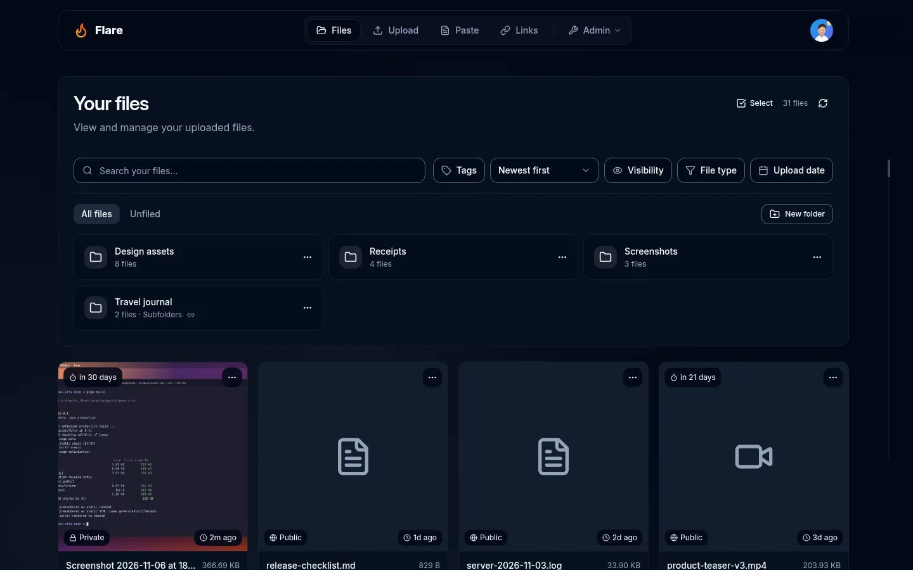
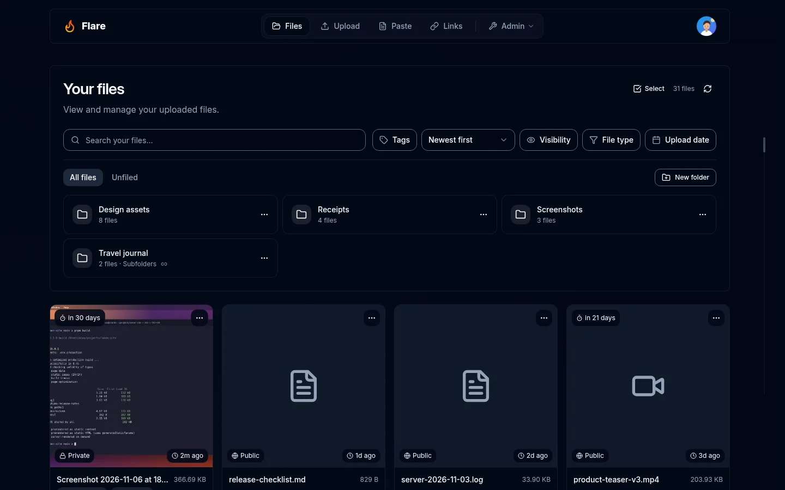

# Directions tested on the real app

These are **prototype captures**, not the final implementation. Both directions were applied as temporary CSS to the same isolated baseline app at `http://localhost:3191` before implementation. The original indexes record captures at 2026-11-06 18:18 UTC. The complete frames below retain their native geometry; WebP quality 84 is the only image conversion. Source index, capture timestamp, injected CSS, source hashes, and export hashes are in [extras-manifest.json](extras-manifest.json).

**Chosen: Calm.** The Calm prototype lifted dark panels slightly within the existing card hue, quieted the glow, and tightened headings while preserving rounded surfaces. Flat tested smaller corners, removed panel shadows/blur, reduced the glow further, and removed header separators. The task chose Calm because surface separation and familiar shapes kept files and forms easier to scan and preserved Flare’s identity. This is the recorded design decision, not a quantitative accessibility or council approval claim. Later implementation also improved task structure; these prototypes do not contain those final behavior changes.

Full-page prototype captures can show a seam where their fixed background ends at the original viewport. That is a capture artifact in these experiments, not an app bug or edited screenshot. The library frames use the actual viewport. Later before/after evidence uses identical full-page capture handling for both sides.

The original temporary styles are included as [calm.css](directions/calm.css) and [flat.css](directions/flat.css).

| Route and viewport        | Calm prototype                                                         | Flat prototype                                                         |
| ------------------------- | ---------------------------------------------------------------------- | ---------------------------------------------------------------------- |
| library, desktop          | [Complete frame](directions/frames/calm/desktop/library.webp)          | [Complete frame](directions/frames/flat/desktop/library.webp)          |
| upload, desktop           | [Complete frame](directions/frames/calm/desktop/upload.webp)           | [Complete frame](directions/frames/flat/desktop/upload.webp)           |
| paste, desktop            | [Complete frame](directions/frames/calm/desktop/paste.webp)            | [Complete frame](directions/frames/flat/desktop/paste.webp)            |
| profile-account, desktop  | [Complete frame](directions/frames/calm/desktop/profile-account.webp)  | [Complete frame](directions/frames/flat/desktop/profile-account.webp)  |
| settings-general, desktop | [Complete frame](directions/frames/calm/desktop/settings-general.webp) | [Complete frame](directions/frames/flat/desktop/settings-general.webp) |
| library, mobile           | [Complete frame](directions/frames/calm/mobile/library.webp)           | [Complete frame](directions/frames/flat/mobile/library.webp)           |
| upload, mobile            | [Complete frame](directions/frames/calm/mobile/upload.webp)            | [Complete frame](directions/frames/flat/mobile/upload.webp)            |
| paste, mobile             | [Complete frame](directions/frames/calm/mobile/paste.webp)             | [Complete frame](directions/frames/flat/mobile/paste.webp)             |
| profile-account, mobile   | [Complete frame](directions/frames/calm/mobile/profile-account.webp)   | [Complete frame](directions/frames/flat/mobile/profile-account.webp)   |
| settings-general, mobile  | [Complete frame](directions/frames/calm/mobile/settings-general.webp)  | [Complete frame](directions/frames/flat/mobile/settings-general.webp)  |

## Library prototypes, desktop

### Calm

### Flat

