# UI Hillclimb: before and after

Real application captures: baseline **before**, implementation **final**. Screens use isolated demonstration data. The comparison cards are explicitly labeled assemblies of complete frames, scaled equally; links open each native frame. New focused states have after-only evidence and no invented baseline. Full-page captures can show a fixed-background seam at the original viewport height on both versions; this is a capture artifact.

## Key changes

### Library, dark desktop

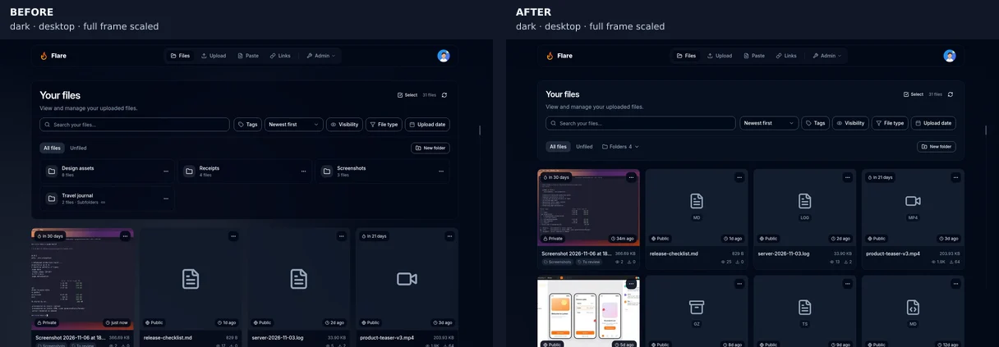

Paired full frames, scaled equally. [Before](frames/workspace/dark/desktop/library-before.webp) · [After](frames/workspace/dark/desktop/library-after.webp)

### Library, light desktop

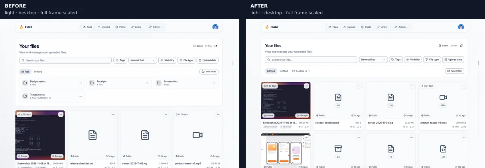

Paired full frames, scaled equally. [Before](frames/workspace/light/desktop/library-before.webp) · [After](frames/workspace/light/desktop/library-after.webp)

### Library on a phone

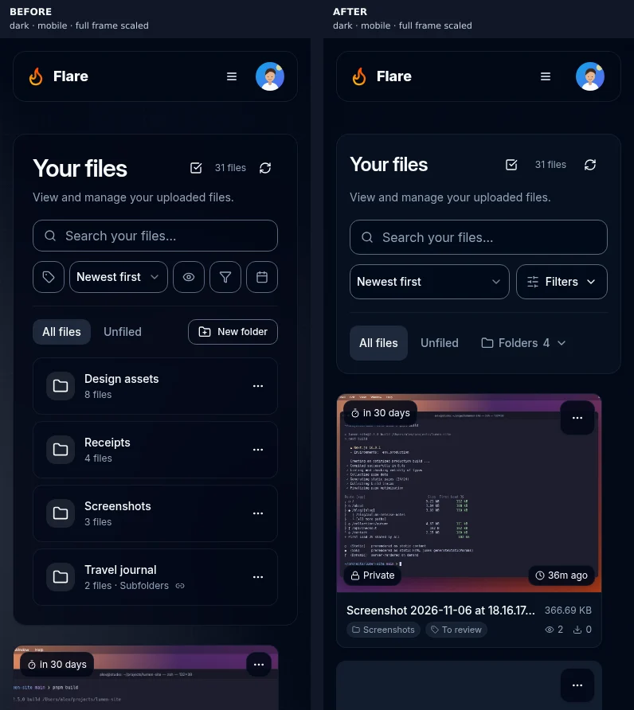

Paired full frames, scaled equally. [Before](frames/workspace/dark/mobile/library-before.webp) · [After](frames/workspace/dark/mobile/library-after.webp)

### Upload with saved defaults

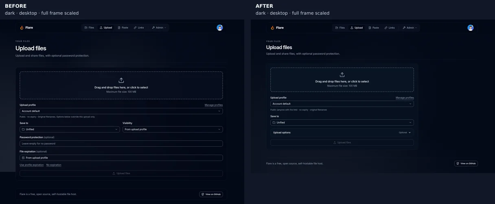

Paired full frames, scaled equally. [Before](frames/workspace/dark/desktop/upload-before.webp) · [After](../../../docs/images/workspace/upload.png)

### Upload in light mode

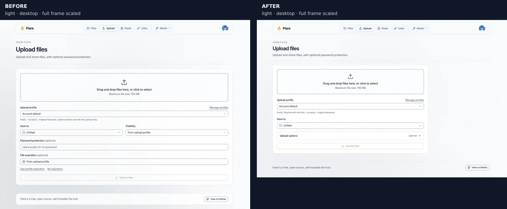

Paired full frames, scaled equally. [Before](frames/workspace/light/desktop/upload-before.webp) · [After](frames/workspace/light/desktop/upload-after.webp)

### Upload options on a phone

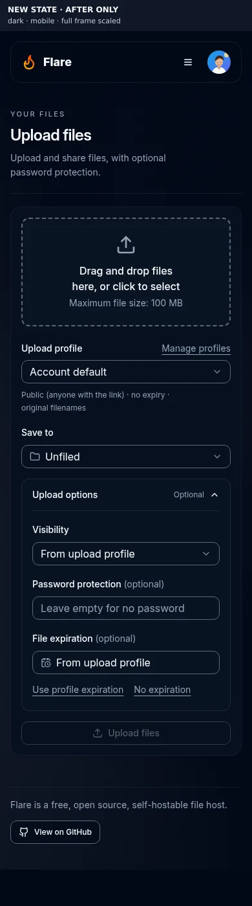

New focused state, after only. [After](frames/workspace/dark/mobile/upload-options-after.webp)

### Upload password recovery

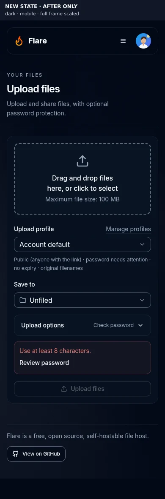

New focused state, after only. [After](frames/workspace/dark/mobile/upload-invalid-password-after.webp)

### Paste content and optional settings

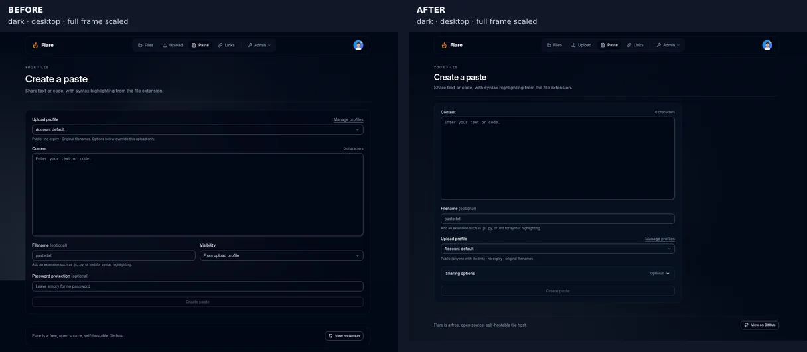

Paired full frames, scaled equally. [Before](frames/workspace/dark/desktop/paste-before.webp) · [After](../../../docs/images/workspace/paste.png)

### Paste options in light mode

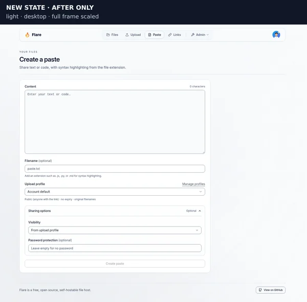

New focused state, after only. [After](frames/workspace/light/desktop/paste-options-after.webp)

### Paste password recovery

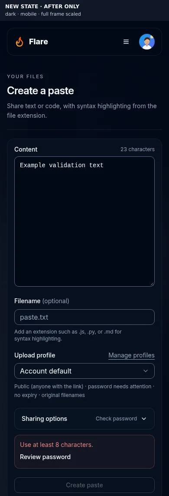

New focused state, after only. [After](frames/workspace/dark/mobile/paste-invalid-password-after.webp)

### Account shortcuts and section navigation

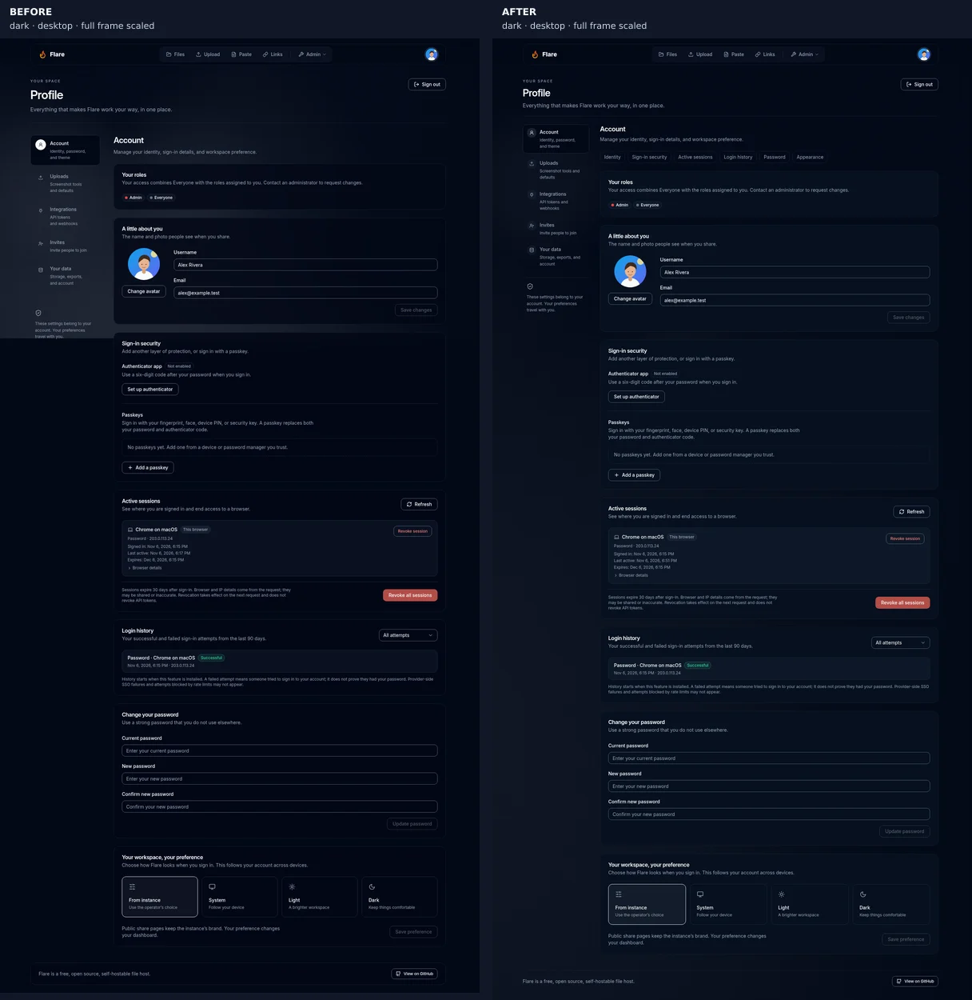

Paired full frames, scaled equally. [Before](frames/workspace/dark/desktop/profile-account-before.webp) · [After](../../../docs/images/preferences-grouping/profile-account-desktop.png)

### Account navigation on a phone

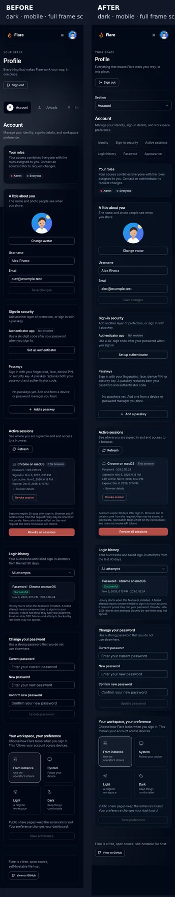

Paired full frames, scaled equally. [Before](frames/workspace/dark/mobile/profile-account-before.webp) · [After](frames/workspace/dark/mobile/profile-account-after.webp)

### Complete phone section picker

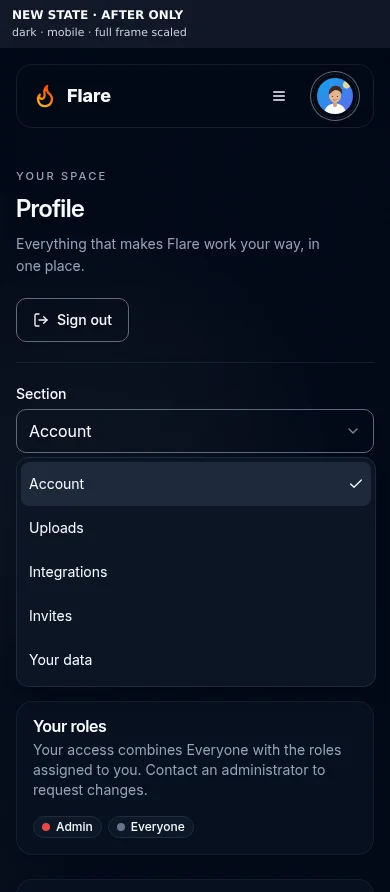

New focused state, after only. [After](frames/workspace/dark/mobile/profile-section-open-after.webp)

### Account row actions

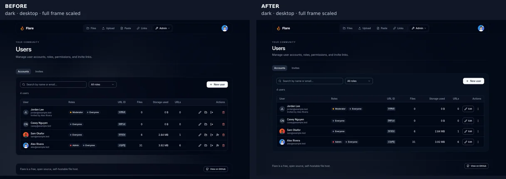

Paired full frames, scaled equally. [Before](frames/workspace/dark/desktop/users-before.webp) · [After](../../../docs/images/roles/users-overview.webp)

### User secondary-action menu

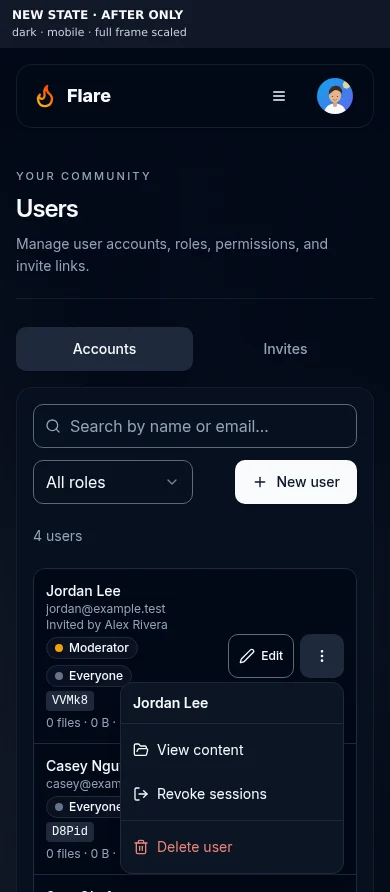

New focused state, after only. [After](frames/workspace/dark/mobile/user-actions-after.webp)

### Role permission groups

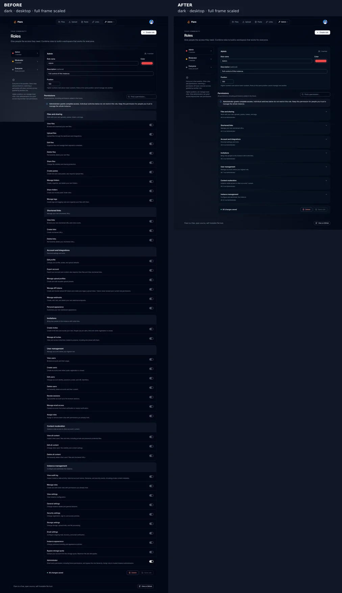

Paired full frames, scaled equally. [Before](frames/workspace/dark/desktop/roles-before.webp) · [After](../../../docs/images/roles/roles-overview.webp)

### Role access summaries in light mode

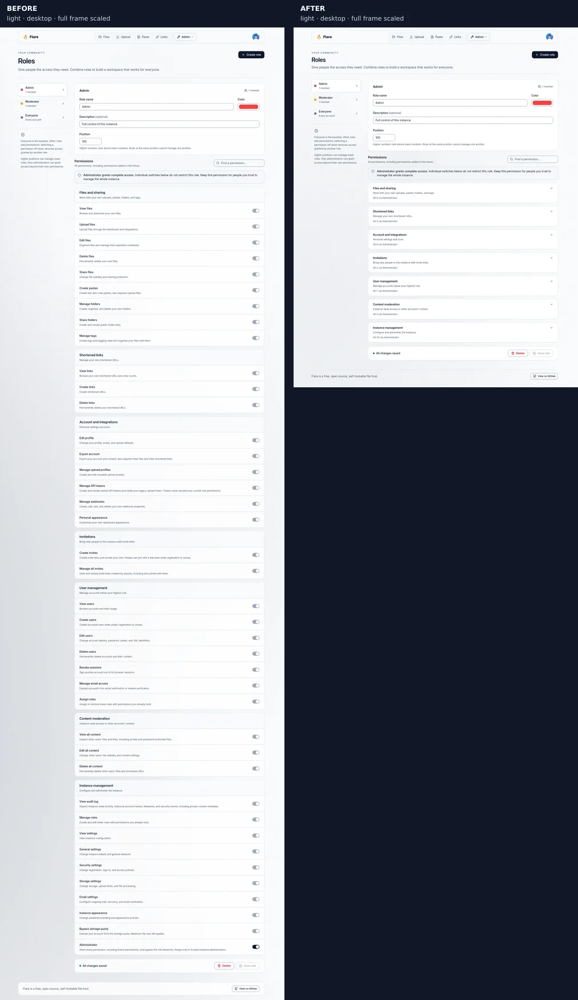

Paired full frames, scaled equally. [Before](frames/workspace/light/desktop/roles-before.webp) · [After](frames/workspace/light/desktop/roles-after.webp)

### Request-heavy activity scan

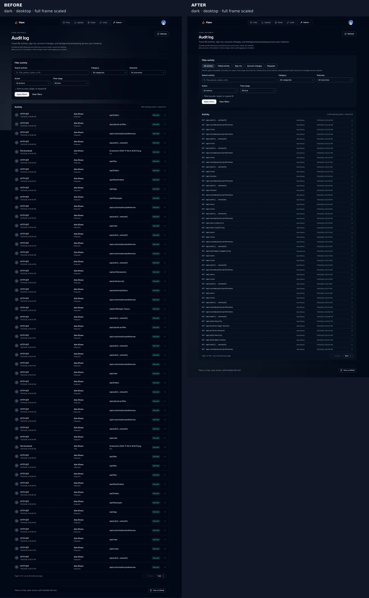

Paired full frames, scaled equally. [Before](frames/workspace/dark/desktop/audit-before.webp) · [After](frames/workspace/dark/desktop/audit-after.webp)

### Activity scan in light mode

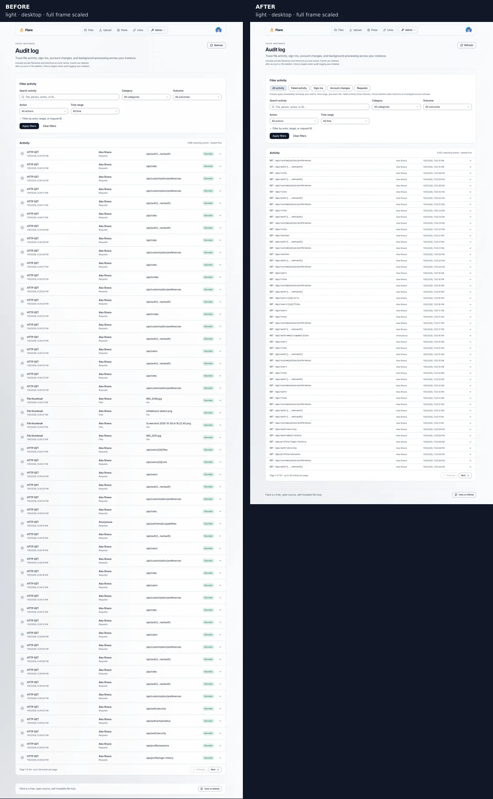

Paired full frames, scaled equally. [Before](frames/workspace/light/desktop/audit-before.webp) · [After](frames/workspace/light/desktop/audit-after.webp)

### Activity on a phone

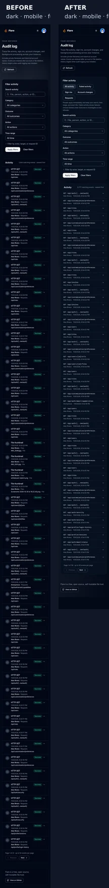

Paired full frames, scaled equally. [Before](frames/workspace/dark/mobile/audit-before.webp) · [After](frames/workspace/dark/mobile/audit-after.webp)

### Requests investigation preset

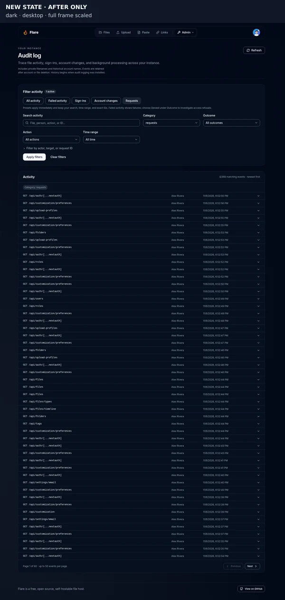

New focused state, after only. [After](frames/workspace/dark/desktop/audit-requests-after.webp)

### Sign-in on a phone

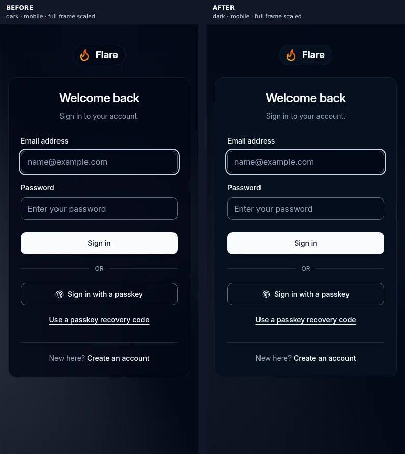

Paired full frames, scaled equally. [Before](frames/public/dark/mobile/login-before.webp) · [After](frames/public/dark/mobile/login-after.webp)

## Measured text contrast

These counts come directly from the recorded contrast audits. They cover the listed sampled routes, not every screenshot in this gallery. Covered/offscreen elements were not measured. Missing metric files remain unavailable; a blank is never treated as a pass.

| Mode / viewport | Before measured | Before below AA | After measured | After below AA | Scope                                |
| --------------- | --------------: | --------------: | -------------: | -------------: | ------------------------------------ |
| dark / desktop  |             869 |               0 |            955 |              0 | Route sets differ; compare with care |
| dark / mobile   |             728 |               0 |            774 |              0 | Route sets differ; compare with care |
| light / desktop |             866 |               0 |            967 |              0 | Route sets differ; compare with care |
| light / mobile  |             722 |               0 |            782 |              0 | Route sets differ; compare with care |

[Metric counts and exact route sets](metrics.json). Unmeasured counts by reason are included there. APCA body-text heuristic counts are retained separately from WCAG AA failures.

## Focus indicators

The focus script uses screenshot-change heuristics. No-visible-change flags and weak-change flags are separate measurements. A weak-change flag does not establish a missing indicator; it needs inspection of the actual ring, background and interaction. These are recorded flags, not a claim of app-wide keyboard compliance.

| Mode / viewport | Before stops | Before no-visible-change flags | Before weak-change flags | After stops | After no-visible-change flags | After weak-change flags |
| --------------- | -----------: | -----------------------------: | -----------------------: | ----------: | ----------------------------: | ----------------------: |
| dark / mobile   |  Unavailable |                    Unavailable |              Unavailable |         146 |                             0 |                      10 |
| light / mobile  |          146 |                              0 |                        2 |         146 |                             0 |                       3 |

## Full capture scope

Pairs are matched by area, route/state name, theme and viewport. Capture failures and missing files are explicit gaps. Runtime notices, including intentionally rejected sign-ins and missing-page responses, are retained in the [manifest](manifest.json) and do not become fabricated successful captures. Credential-bearing captures require an explicit masking receipt for authenticator QR/setup secrets; blocked inputs remain gaps. Redacted controls are labeled in the table and provenance. Canonical handbook images are reused by link only when their actual source and current target SHA-256 match the applied refresh receipt.

### Workspace

#### dark / desktop

| Page or state                             | Before                                                                   | After                                                                         | Result                               |
| ----------------------------------------- | ------------------------------------------------------------------------ | ----------------------------------------------------------------------------- | ------------------------------------ |
| Archive contents                          | [Open](frames/workspace/dark/desktop/archive-browser-before.webp)        | [Open](frames/workspace/dark/desktop/archive-browser-after.webp)              | paired                               |
| Create archive dialog                     | [Open](frames/workspace/dark/desktop/archive-create-before.webp)         | [Open](frames/workspace/dark/desktop/archive-create-after.webp)               | paired                               |
| Instance audit activity                   | [Open](frames/workspace/dark/desktop/audit-before.webp)                  | [Open](frames/workspace/dark/desktop/audit-after.webp)                        | paired                               |
| Failure investigation preset              | No equivalent baseline capture                                           | [Open](frames/workspace/dark/desktop/audit-failure-after.webp)                | new state                            |
| HTTP request investigation preset         | No equivalent baseline capture                                           | [Open](frames/workspace/dark/desktop/audit-requests-after.webp)               | new state                            |
| Sign-in investigation preset              | No equivalent baseline capture                                           | [Open](frames/workspace/dark/desktop/audit-signins-after.webp)                | new state                            |
| File action menu                          | [Open](frames/workspace/dark/desktop/card-menu-before.webp)              | [Open](frames/workspace/dark/desktop/card-menu-after.webp)                    | paired                               |
| Missing dashboard page                    | [Open](frames/workspace/dark/desktop/dashboard-404-before.webp)          | [Open](frames/workspace/dark/desktop/dashboard-404-after.webp)                | paired; 4 capture notices            |
| File deletion confirmation                | [Open](frames/workspace/dark/desktop/dialog-delete-before.webp)          | [Open](frames/workspace/dark/desktop/dialog-delete-after.webp)                | paired                               |
| File expiration dialog                    | [Open](frames/workspace/dark/desktop/dialog-expiry-before.webp)          | [Open](frames/workspace/dark/desktop/dialog-expiry-after.webp)                | paired                               |
| Move files dialog                         | [Open](frames/workspace/dark/desktop/dialog-move-before.webp)            | [Open](frames/workspace/dark/desktop/dialog-move-after.webp)                  | paired                               |
| File password dialog                      | [Open](frames/workspace/dark/desktop/dialog-password-before.webp)        | [Open](frames/workspace/dark/desktop/dialog-password-after.webp)              | paired                               |
| File tags dialog                          | [Open](frames/workspace/dark/desktop/dialog-tags-before.webp)            | [Open](frames/workspace/dark/desktop/dialog-tags-after.webp)                  | paired                               |
| File visibility dialog                    | [Open](frames/workspace/dark/desktop/dialog-visibility-before.webp)      | [Open](frames/workspace/dark/desktop/dialog-visibility-after.webp)            | paired                               |
| Upload-date filter                        | [Open](frames/workspace/dark/desktop/filter-date-before.webp)            | [Open](frames/workspace/dark/desktop/filter-date-after.webp)                  | paired                               |
| Sort choices                              | [Open](frames/workspace/dark/desktop/filter-sort-before.webp)            | [Open](frames/workspace/dark/desktop/filter-sort-after.webp)                  | paired                               |
| Tags filter menu                          | [Open](frames/workspace/dark/desktop/filter-tags-before.webp)            | [Open](frames/workspace/dark/desktop/filter-tags-after.webp)                  | paired                               |
| File-type filter menu                     | [Open](frames/workspace/dark/desktop/filter-type-before.webp)            | [Open](frames/workspace/dark/desktop/filter-type-after.webp)                  | paired                               |
| Folder action menu                        | [Open](frames/workspace/dark/desktop/folder-menu-before.webp)            | [Open](frames/workspace/dark/desktop/folder-menu-after.webp)                  | paired                               |
| Create folder dialog                      | [Open](frames/workspace/dark/desktop/folder-new-before.webp)             | [Open](frames/workspace/dark/desktop/folder-new-after.webp)                   | paired                               |
| Create invite dialog                      | [Open](frames/workspace/dark/desktop/invites-create-before.webp)         | [Open](frames/workspace/dark/desktop/invites-create-after.webp)               | paired; credential controls redacted |
| File library                              | [Open](frames/workspace/dark/desktop/library-before.webp)                | [Open](frames/workspace/dark/desktop/library-after.webp)                      | paired                               |
| Private/protected file filters            | [Open](frames/workspace/dark/desktop/library-filters-before.webp)        | [Open](frames/workspace/dark/desktop/library-filters-after.webp)              | paired                               |
| Library inside a folder                   | [Open](frames/workspace/dark/desktop/library-folder-before.webp)         | [Open](frames/workspace/dark/desktop/library-folder-after.webp)               | paired; 2 capture notices            |
| Expanded folder directory                 | No equivalent baseline capture                                           | [Open](frames/workspace/dark/desktop/library-folders-after.webp)              | new state                            |
| Library grouped by upload period          | [Open](frames/workspace/dark/desktop/library-grouped-before.webp)        | [Open](frames/workspace/dark/desktop/library-grouped-after.webp)              | paired                               |
| Library after scrolling                   | [Open](frames/workspace/dark/desktop/library-scrolled-before.webp)       | [Open](frames/workspace/dark/desktop/library-scrolled-after.webp)             | paired                               |
| Search with no matching files             | [Open](frames/workspace/dark/desktop/library-search-empty-before.webp)   | [Open](frames/workspace/dark/desktop/library-search-empty-after.webp)         | paired                               |
| File selection and batch actions          | [Open](frames/workspace/dark/desktop/library-select-before.webp)         | [Open](frames/workspace/dark/desktop/library-select-after.webp)               | paired                               |
| Short links and copy actions              | [Open](frames/workspace/dark/desktop/links-before.webp)                  | [Open](../../../docs/images/workspace/urls.png)                               | paired                               |
| Short-link deletion confirmation          | [Open](frames/workspace/dark/desktop/links-delete-before.webp)           | [Open](frames/workspace/dark/desktop/links-delete-after.webp)                 | paired                               |
| Navigation at this viewport               | [Open](frames/workspace/dark/desktop/mobile-nav-before.webp)             | [Open](frames/workspace/dark/desktop/mobile-nav-after.webp)                   | paired                               |
| Content-first paste form                  | [Open](frames/workspace/dark/desktop/paste-before.webp)                  | [Open](../../../docs/images/workspace/paste.png)                              | paired                               |
| paste invalid open                        | No equivalent baseline capture                                           | [Open](frames/workspace/dark/desktop/paste-invalid-open-after.webp)           | new state                            |
| Paste password validation                 | No equivalent baseline capture                                           | [Open](frames/workspace/dark/desktop/paste-invalid-password-after.webp)       | new state                            |
| Paste sharing options expanded            | No equivalent baseline capture                                           | [Open](frames/workspace/dark/desktop/paste-options-after.webp)                | new state                            |
| Authenticator setup confirmation          | [Open](frames/workspace/dark/desktop/profile-2fa-before.webp)            | [Open](frames/workspace/dark/desktop/profile-2fa-after.webp)                  | paired; credential controls redacted |
| Account and shortcuts                     | [Open](frames/workspace/dark/desktop/profile-account-before.webp)        | [Open](../../../docs/images/preferences-grouping/profile-account-desktop.png) | paired                               |
| Storage, export and account deletion      | [Open](frames/workspace/dark/desktop/profile-data-before.webp)           | [Open](../../../docs/images/workspace/profile-data.png)                       | paired                               |
| Account deletion confirmation             | [Open](frames/workspace/dark/desktop/profile-delete-account-before.webp) | [Open](frames/workspace/dark/desktop/profile-delete-account-after.webp)       | paired                               |
| API tokens, webhooks and delivery history | [Open](frames/workspace/dark/desktop/profile-integrations-before.webp)   | [Open](../../../docs/images/handbook/integrations.webp)                       | paired                               |
| Personal invite links                     | [Open](frames/workspace/dark/desktop/profile-invites-before.webp)        | [Open](frames/workspace/dark/desktop/profile-invites-after.webp)              | paired                               |
| Upload-token replacement confirmation     | [Open](frames/workspace/dark/desktop/profile-token-replace-before.webp)  | [Open](frames/workspace/dark/desktop/profile-token-replace-after.webp)        | paired; credential controls redacted |
| Account upload tools and profiles         | [Open](frames/workspace/dark/desktop/profile-uploads-before.webp)        | [Open](frames/workspace/dark/desktop/profile-uploads-after.webp)              | paired                               |
| Role groups and access summary            | [Open](frames/workspace/dark/desktop/roles-before.webp)                  | [Open](../../../docs/images/roles/roles-overview.webp)                        | paired                               |
| Create role form                          | [Open](frames/workspace/dark/desktop/roles-create-before.webp)           | [Open](frames/workspace/dark/desktop/roles-create-after.webp)                 | paired                               |
| Expanded permission group                 | No equivalent baseline capture                                           | [Open](frames/workspace/dark/desktop/roles-expanded-after.webp)               | new state                            |
| Moderator role                            | [Open](frames/workspace/dark/desktop/roles-moderator-before.webp)        | [Open](frames/workspace/dark/desktop/roles-moderator-after.webp)              | paired                               |
| Access and registration settings          | [Open](frames/workspace/dark/desktop/settings-access-before.webp)        | [Open](../../../docs/images/preferences/settings-access.png)                  | paired                               |
| Appearance administration                 | [Open](frames/workspace/dark/desktop/settings-appearance-before.webp)    | [Open](frames/workspace/dark/desktop/settings-appearance-after.webp)          | paired                               |
| Email administration                      | [Open](frames/workspace/dark/desktop/settings-email-before.webp)         | [Open](frames/workspace/dark/desktop/settings-email-after.webp)               | paired                               |
| General instance settings                 | [Open](frames/workspace/dark/desktop/settings-general-before.webp)       | [Open](../../../docs/images/documentation-links/settings-desktop.webp)        | paired                               |
| Storage settings                          | [Open](frames/workspace/dark/desktop/settings-storage-before.webp)       | [Open](../../../docs/images/preferences/settings-storage.png)                 | paired                               |
| Setup appearance step                     | [Open](frames/workspace/dark/desktop/setup-appearance-before.webp)       | [Open](../../../docs/images/documentation-links/setup-appearance.webp)        | paired                               |
| Setup email step                          | [Open](frames/workspace/dark/desktop/setup-email-before.webp)            | [Open](../../../docs/images/documentation-links/setup-email.webp)             | paired                               |
| Setup completion step                     | [Open](frames/workspace/dark/desktop/setup-ready-before.webp)            | [Open](frames/workspace/dark/desktop/setup-ready-after.webp)                  | paired                               |
| Copy-link result notice                   | [Open](frames/workspace/dark/desktop/toast-before.webp)                  | [Open](frames/workspace/dark/desktop/toast-after.webp)                        | paired                               |
| Upload with account defaults              | [Open](frames/workspace/dark/desktop/upload-before.webp)                 | [Open](../../../docs/images/workspace/upload.png)                             | paired                               |
| upload invalid open                       | No equivalent baseline capture                                           | [Open](frames/workspace/dark/desktop/upload-invalid-open-after.webp)          | new state                            |
| Upload password validation                | No equivalent baseline capture                                           | [Open](frames/workspace/dark/desktop/upload-invalid-password-after.webp)      | new state                            |
| Upload options expanded                   | No equivalent baseline capture                                           | [Open](frames/workspace/dark/desktop/upload-options-after.webp)               | new state                            |
| Selected upload queue                     | [Open](frames/workspace/dark/desktop/upload-queued-before.webp)          | [Open](../../../docs/images/workspace/upload-queue.png)                       | paired                               |
| User secondary-action menu                | No equivalent baseline capture                                           | [Open](frames/workspace/dark/desktop/user-actions-after.webp)                 | new state                            |
| User accounts                             | [Open](frames/workspace/dark/desktop/users-before.webp)                  | [Open](../../../docs/images/roles/users-overview.webp)                        | paired                               |
| User content inspection                   | [Open](frames/workspace/dark/desktop/users-content-before.webp)          | [Open](frames/workspace/dark/desktop/users-content-after.webp)                | paired                               |
| User deletion confirmation                | [Open](frames/workspace/dark/desktop/users-delete-before.webp)           | [Open](frames/workspace/dark/desktop/users-delete-after.webp)                 | paired                               |
| Edit user dialog                          | [Open](frames/workspace/dark/desktop/users-edit-before.webp)             | [Open](frames/workspace/dark/desktop/users-edit-after.webp)                   | paired                               |
| Instance invite links                     | [Open](frames/workspace/dark/desktop/users-invites-before.webp)          | [Open](frames/workspace/dark/desktop/users-invites-after.webp)                | paired                               |
| Create user dialog                        | [Open](frames/workspace/dark/desktop/users-new-before.webp)              | [Open](frames/workspace/dark/desktop/users-new-after.webp)                    | paired                               |

#### dark / mobile

| Page or state                             | Before                                                                  | After                                                                   | Result                               |
| ----------------------------------------- | ----------------------------------------------------------------------- | ----------------------------------------------------------------------- | ------------------------------------ |
| Archive contents                          | [Open](frames/workspace/dark/mobile/archive-browser-before.webp)        | [Open](frames/workspace/dark/mobile/archive-browser-after.webp)         | paired                               |
| Create archive dialog                     | [Open](frames/workspace/dark/mobile/archive-create-before.webp)         | [Open](frames/workspace/dark/mobile/archive-create-after.webp)          | paired                               |
| Instance audit activity                   | [Open](frames/workspace/dark/mobile/audit-before.webp)                  | [Open](frames/workspace/dark/mobile/audit-after.webp)                   | paired                               |
| Failure investigation preset              | No equivalent baseline capture                                          | [Open](frames/workspace/dark/mobile/audit-failure-after.webp)           | new state                            |
| HTTP request investigation preset         | No equivalent baseline capture                                          | [Open](frames/workspace/dark/mobile/audit-requests-after.webp)          | new state                            |
| Sign-in investigation preset              | No equivalent baseline capture                                          | [Open](frames/workspace/dark/mobile/audit-signins-after.webp)           | new state                            |
| File action menu                          | [Open](frames/workspace/dark/mobile/card-menu-before.webp)              | [Open](frames/workspace/dark/mobile/card-menu-after.webp)               | paired                               |
| Missing dashboard page                    | [Open](frames/workspace/dark/mobile/dashboard-404-before.webp)          | [Open](frames/workspace/dark/mobile/dashboard-404-after.webp)           | paired; 4 capture notices            |
| File deletion confirmation                | [Open](frames/workspace/dark/mobile/dialog-delete-before.webp)          | [Open](frames/workspace/dark/mobile/dialog-delete-after.webp)           | paired                               |
| File expiration dialog                    | [Open](frames/workspace/dark/mobile/dialog-expiry-before.webp)          | [Open](frames/workspace/dark/mobile/dialog-expiry-after.webp)           | paired                               |
| Move files dialog                         | [Open](frames/workspace/dark/mobile/dialog-move-before.webp)            | [Open](frames/workspace/dark/mobile/dialog-move-after.webp)             | paired                               |
| File password dialog                      | [Open](frames/workspace/dark/mobile/dialog-password-before.webp)        | [Open](frames/workspace/dark/mobile/dialog-password-after.webp)         | paired                               |
| File tags dialog                          | [Open](frames/workspace/dark/mobile/dialog-tags-before.webp)            | [Open](frames/workspace/dark/mobile/dialog-tags-after.webp)             | paired                               |
| File visibility dialog                    | [Open](frames/workspace/dark/mobile/dialog-visibility-before.webp)      | [Open](frames/workspace/dark/mobile/dialog-visibility-after.webp)       | paired                               |
| Upload-date filter                        | [Open](frames/workspace/dark/mobile/filter-date-before.webp)            | [Open](frames/workspace/dark/mobile/filter-date-after.webp)             | paired                               |
| Sort choices                              | [Open](frames/workspace/dark/mobile/filter-sort-before.webp)            | [Open](frames/workspace/dark/mobile/filter-sort-after.webp)             | paired                               |
| Tags filter menu                          | [Open](frames/workspace/dark/mobile/filter-tags-before.webp)            | [Open](frames/workspace/dark/mobile/filter-tags-after.webp)             | paired                               |
| File-type filter menu                     | [Open](frames/workspace/dark/mobile/filter-type-before.webp)            | [Open](frames/workspace/dark/mobile/filter-type-after.webp)             | paired                               |
| Folder action menu                        | [Open](frames/workspace/dark/mobile/folder-menu-before.webp)            | [Open](frames/workspace/dark/mobile/folder-menu-after.webp)             | paired                               |
| Create folder dialog                      | [Open](frames/workspace/dark/mobile/folder-new-before.webp)             | [Open](frames/workspace/dark/mobile/folder-new-after.webp)              | paired                               |
| Create invite dialog                      | [Open](frames/workspace/dark/mobile/invites-create-before.webp)         | [Open](frames/workspace/dark/mobile/invites-create-after.webp)          | paired; credential controls redacted |
| File library                              | [Open](frames/workspace/dark/mobile/library-before.webp)                | [Open](frames/workspace/dark/mobile/library-after.webp)                 | paired                               |
| Private/protected file filters            | [Open](frames/workspace/dark/mobile/library-filters-before.webp)        | [Open](frames/workspace/dark/mobile/library-filters-after.webp)         | paired                               |
| Library inside a folder                   | [Open](frames/workspace/dark/mobile/library-folder-before.webp)         | [Open](frames/workspace/dark/mobile/library-folder-after.webp)          | paired                               |
| Expanded folder directory                 | No equivalent baseline capture                                          | [Open](frames/workspace/dark/mobile/library-folders-after.webp)         | new state                            |
| Library grouped by upload period          | [Open](frames/workspace/dark/mobile/library-grouped-before.webp)        | [Open](frames/workspace/dark/mobile/library-grouped-after.webp)         | paired                               |
| Library after scrolling                   | [Open](frames/workspace/dark/mobile/library-scrolled-before.webp)       | [Open](frames/workspace/dark/mobile/library-scrolled-after.webp)        | paired                               |
| Search with no matching files             | [Open](frames/workspace/dark/mobile/library-search-empty-before.webp)   | [Open](frames/workspace/dark/mobile/library-search-empty-after.webp)    | paired                               |
| File selection and batch actions          | [Open](frames/workspace/dark/mobile/library-select-before.webp)         | [Open](frames/workspace/dark/mobile/library-select-after.webp)          | paired                               |
| Short links and copy actions              | [Open](frames/workspace/dark/mobile/links-before.webp)                  | [Open](frames/workspace/dark/mobile/links-after.webp)                   | paired                               |
| Short-link deletion confirmation          | [Open](frames/workspace/dark/mobile/links-delete-before.webp)           | [Open](frames/workspace/dark/mobile/links-delete-after.webp)            | paired                               |
| Navigation at this viewport               | [Open](frames/workspace/dark/mobile/mobile-nav-before.webp)             | [Open](frames/workspace/dark/mobile/mobile-nav-after.webp)              | paired                               |
| Content-first paste form                  | [Open](frames/workspace/dark/mobile/paste-before.webp)                  | [Open](frames/workspace/dark/mobile/paste-after.webp)                   | paired                               |
| paste invalid open                        | No equivalent baseline capture                                          | [Open](frames/workspace/dark/mobile/paste-invalid-open-after.webp)      | new state                            |
| Paste password validation                 | No equivalent baseline capture                                          | [Open](frames/workspace/dark/mobile/paste-invalid-password-after.webp)  | new state                            |
| Paste sharing options expanded            | No equivalent baseline capture                                          | [Open](frames/workspace/dark/mobile/paste-options-after.webp)           | new state                            |
| Authenticator setup confirmation          | [Open](frames/workspace/dark/mobile/profile-2fa-before.webp)            | [Open](frames/workspace/dark/mobile/profile-2fa-after.webp)             | paired; credential controls redacted |
| Account and shortcuts                     | [Open](frames/workspace/dark/mobile/profile-account-before.webp)        | [Open](frames/workspace/dark/mobile/profile-account-after.webp)         | paired                               |
| Storage, export and account deletion      | [Open](frames/workspace/dark/mobile/profile-data-before.webp)           | [Open](frames/workspace/dark/mobile/profile-data-after.webp)            | paired                               |
| Account deletion confirmation             | [Open](frames/workspace/dark/mobile/profile-delete-account-before.webp) | [Open](frames/workspace/dark/mobile/profile-delete-account-after.webp)  | paired                               |
| API tokens, webhooks and delivery history | [Open](frames/workspace/dark/mobile/profile-integrations-before.webp)   | [Open](frames/workspace/dark/mobile/profile-integrations-after.webp)    | paired                               |
| Personal invite links                     | [Open](frames/workspace/dark/mobile/profile-invites-before.webp)        | [Open](frames/workspace/dark/mobile/profile-invites-after.webp)         | paired                               |
| Complete Profile section picker           | No equivalent baseline capture                                          | [Open](frames/workspace/dark/mobile/profile-section-open-after.webp)    | new state                            |
| Upload-token replacement confirmation     | [Open](frames/workspace/dark/mobile/profile-token-replace-before.webp)  | [Open](frames/workspace/dark/mobile/profile-token-replace-after.webp)   | paired; credential controls redacted |
| Account upload tools and profiles         | [Open](frames/workspace/dark/mobile/profile-uploads-before.webp)        | [Open](frames/workspace/dark/mobile/profile-uploads-after.webp)         | paired                               |
| Role groups and access summary            | [Open](frames/workspace/dark/mobile/roles-before.webp)                  | [Open](frames/workspace/dark/mobile/roles-after.webp)                   | paired                               |
| Create role form                          | [Open](frames/workspace/dark/mobile/roles-create-before.webp)           | [Open](frames/workspace/dark/mobile/roles-create-after.webp)            | paired                               |
| Expanded permission group                 | No equivalent baseline capture                                          | [Open](frames/workspace/dark/mobile/roles-expanded-after.webp)          | new state                            |
| Moderator role                            | [Open](frames/workspace/dark/mobile/roles-moderator-before.webp)        | [Open](frames/workspace/dark/mobile/roles-moderator-after.webp)         | paired                               |
| Access and registration settings          | [Open](frames/workspace/dark/mobile/settings-access-before.webp)        | [Open](frames/workspace/dark/mobile/settings-access-after.webp)         | paired                               |
| Appearance administration                 | [Open](frames/workspace/dark/mobile/settings-appearance-before.webp)    | [Open](frames/workspace/dark/mobile/settings-appearance-after.webp)     | paired                               |
| Email administration                      | [Open](frames/workspace/dark/mobile/settings-email-before.webp)         | [Open](frames/workspace/dark/mobile/settings-email-after.webp)          | paired                               |
| General instance settings                 | [Open](frames/workspace/dark/mobile/settings-general-before.webp)       | [Open](../../../docs/images/documentation-links/settings-mobile.webp)   | paired                               |
| Storage settings                          | [Open](frames/workspace/dark/mobile/settings-storage-before.webp)       | [Open](frames/workspace/dark/mobile/settings-storage-after.webp)        | paired                               |
| Setup appearance step                     | [Open](frames/workspace/dark/mobile/setup-appearance-before.webp)       | [Open](frames/workspace/dark/mobile/setup-appearance-after.webp)        | paired                               |
| Setup email step                          | [Open](frames/workspace/dark/mobile/setup-email-before.webp)            | [Open](frames/workspace/dark/mobile/setup-email-after.webp)             | paired                               |
| Setup completion step                     | [Open](frames/workspace/dark/mobile/setup-ready-before.webp)            | [Open](frames/workspace/dark/mobile/setup-ready-after.webp)             | paired                               |
| Copy-link result notice                   | [Open](frames/workspace/dark/mobile/toast-before.webp)                  | [Open](frames/workspace/dark/mobile/toast-after.webp)                   | paired                               |
| Upload with account defaults              | [Open](frames/workspace/dark/mobile/upload-before.webp)                 | [Open](frames/workspace/dark/mobile/upload-after.webp)                  | paired                               |
| upload invalid open                       | No equivalent baseline capture                                          | [Open](frames/workspace/dark/mobile/upload-invalid-open-after.webp)     | new state                            |
| Upload password validation                | No equivalent baseline capture                                          | [Open](frames/workspace/dark/mobile/upload-invalid-password-after.webp) | new state                            |
| Upload options expanded                   | No equivalent baseline capture                                          | [Open](frames/workspace/dark/mobile/upload-options-after.webp)          | new state                            |
| Selected upload queue                     | [Open](frames/workspace/dark/mobile/upload-queued-before.webp)          | [Open](frames/workspace/dark/mobile/upload-queued-after.webp)           | paired                               |
| User secondary-action menu                | No equivalent baseline capture                                          | [Open](frames/workspace/dark/mobile/user-actions-after.webp)            | new state                            |
| User accounts                             | [Open](frames/workspace/dark/mobile/users-before.webp)                  | [Open](frames/workspace/dark/mobile/users-after.webp)                   | paired                               |
| User content inspection                   | [Open](frames/workspace/dark/mobile/users-content-before.webp)          | [Open](frames/workspace/dark/mobile/users-content-after.webp)           | paired                               |
| User deletion confirmation                | [Open](frames/workspace/dark/mobile/users-delete-before.webp)           | [Open](frames/workspace/dark/mobile/users-delete-after.webp)            | paired                               |
| Edit user dialog                          | [Open](frames/workspace/dark/mobile/users-edit-before.webp)             | [Open](frames/workspace/dark/mobile/users-edit-after.webp)              | paired                               |
| Instance invite links                     | [Open](frames/workspace/dark/mobile/users-invites-before.webp)          | [Open](frames/workspace/dark/mobile/users-invites-after.webp)           | paired                               |
| Create user dialog                        | [Open](frames/workspace/dark/mobile/users-new-before.webp)              | [Open](frames/workspace/dark/mobile/users-new-after.webp)               | paired                               |

#### light / desktop

| Page or state                             | Before                                                                    | After                                                                     | Result                               |
| ----------------------------------------- | ------------------------------------------------------------------------- | ------------------------------------------------------------------------- | ------------------------------------ |
| Archive contents                          | [Open](frames/workspace/light/desktop/archive-browser-before.webp)        | [Open](frames/workspace/light/desktop/archive-browser-after.webp)         | paired                               |
| Create archive dialog                     | [Open](frames/workspace/light/desktop/archive-create-before.webp)         | [Open](frames/workspace/light/desktop/archive-create-after.webp)          | paired                               |
| Instance audit activity                   | [Open](frames/workspace/light/desktop/audit-before.webp)                  | [Open](frames/workspace/light/desktop/audit-after.webp)                   | paired                               |
| Failure investigation preset              | No equivalent baseline capture                                            | [Open](frames/workspace/light/desktop/audit-failure-after.webp)           | new state                            |
| HTTP request investigation preset         | No equivalent baseline capture                                            | [Open](frames/workspace/light/desktop/audit-requests-after.webp)          | new state                            |
| Sign-in investigation preset              | No equivalent baseline capture                                            | [Open](frames/workspace/light/desktop/audit-signins-after.webp)           | new state                            |
| File action menu                          | [Open](frames/workspace/light/desktop/card-menu-before.webp)              | [Open](frames/workspace/light/desktop/card-menu-after.webp)               | paired                               |
| Missing dashboard page                    | [Open](frames/workspace/light/desktop/dashboard-404-before.webp)          | [Open](frames/workspace/light/desktop/dashboard-404-after.webp)           | paired; 5 capture notices            |
| File deletion confirmation                | [Open](frames/workspace/light/desktop/dialog-delete-before.webp)          | [Open](frames/workspace/light/desktop/dialog-delete-after.webp)           | paired                               |
| File expiration dialog                    | [Open](frames/workspace/light/desktop/dialog-expiry-before.webp)          | [Open](frames/workspace/light/desktop/dialog-expiry-after.webp)           | paired                               |
| Move files dialog                         | [Open](frames/workspace/light/desktop/dialog-move-before.webp)            | [Open](frames/workspace/light/desktop/dialog-move-after.webp)             | paired                               |
| File password dialog                      | [Open](frames/workspace/light/desktop/dialog-password-before.webp)        | [Open](frames/workspace/light/desktop/dialog-password-after.webp)         | paired                               |
| File tags dialog                          | [Open](frames/workspace/light/desktop/dialog-tags-before.webp)            | [Open](frames/workspace/light/desktop/dialog-tags-after.webp)             | paired                               |
| File visibility dialog                    | [Open](frames/workspace/light/desktop/dialog-visibility-before.webp)      | [Open](frames/workspace/light/desktop/dialog-visibility-after.webp)       | paired                               |
| Upload-date filter                        | [Open](frames/workspace/light/desktop/filter-date-before.webp)            | [Open](frames/workspace/light/desktop/filter-date-after.webp)             | paired                               |
| Sort choices                              | [Open](frames/workspace/light/desktop/filter-sort-before.webp)            | [Open](frames/workspace/light/desktop/filter-sort-after.webp)             | paired                               |
| Tags filter menu                          | [Open](frames/workspace/light/desktop/filter-tags-before.webp)            | [Open](frames/workspace/light/desktop/filter-tags-after.webp)             | paired                               |
| File-type filter menu                     | [Open](frames/workspace/light/desktop/filter-type-before.webp)            | [Open](frames/workspace/light/desktop/filter-type-after.webp)             | paired                               |
| Folder action menu                        | [Open](frames/workspace/light/desktop/folder-menu-before.webp)            | [Open](frames/workspace/light/desktop/folder-menu-after.webp)             | paired                               |
| Create folder dialog                      | [Open](frames/workspace/light/desktop/folder-new-before.webp)             | [Open](frames/workspace/light/desktop/folder-new-after.webp)              | paired                               |
| Create invite dialog                      | [Open](frames/workspace/light/desktop/invites-create-before.webp)         | [Open](frames/workspace/light/desktop/invites-create-after.webp)          | paired; credential controls redacted |
| File library                              | [Open](frames/workspace/light/desktop/library-before.webp)                | [Open](frames/workspace/light/desktop/library-after.webp)                 | paired                               |
| Private/protected file filters            | [Open](frames/workspace/light/desktop/library-filters-before.webp)        | [Open](frames/workspace/light/desktop/library-filters-after.webp)         | paired                               |
| Library inside a folder                   | [Open](frames/workspace/light/desktop/library-folder-before.webp)         | [Open](frames/workspace/light/desktop/library-folder-after.webp)          | paired; 2 capture notices            |
| Expanded folder directory                 | No equivalent baseline capture                                            | [Open](frames/workspace/light/desktop/library-folders-after.webp)         | new state                            |
| Library grouped by upload period          | [Open](frames/workspace/light/desktop/library-grouped-before.webp)        | [Open](frames/workspace/light/desktop/library-grouped-after.webp)         | paired                               |
| Library after scrolling                   | [Open](frames/workspace/light/desktop/library-scrolled-before.webp)       | [Open](frames/workspace/light/desktop/library-scrolled-after.webp)        | paired                               |
| Search with no matching files             | [Open](frames/workspace/light/desktop/library-search-empty-before.webp)   | [Open](frames/workspace/light/desktop/library-search-empty-after.webp)    | paired                               |
| File selection and batch actions          | [Open](frames/workspace/light/desktop/library-select-before.webp)         | [Open](frames/workspace/light/desktop/library-select-after.webp)          | paired                               |
| Short links and copy actions              | [Open](frames/workspace/light/desktop/links-before.webp)                  | [Open](frames/workspace/light/desktop/links-after.webp)                   | paired                               |
| Short-link deletion confirmation          | [Open](frames/workspace/light/desktop/links-delete-before.webp)           | [Open](frames/workspace/light/desktop/links-delete-after.webp)            | paired                               |
| Navigation at this viewport               | [Open](frames/workspace/light/desktop/mobile-nav-before.webp)             | [Open](frames/workspace/light/desktop/mobile-nav-after.webp)              | paired                               |
| Content-first paste form                  | [Open](frames/workspace/light/desktop/paste-before.webp)                  | [Open](frames/workspace/light/desktop/paste-after.webp)                   | paired                               |
| paste invalid open                        | No equivalent baseline capture                                            | [Open](frames/workspace/light/desktop/paste-invalid-open-after.webp)      | new state                            |
| Paste password validation                 | No equivalent baseline capture                                            | [Open](frames/workspace/light/desktop/paste-invalid-password-after.webp)  | new state                            |
| Paste sharing options expanded            | No equivalent baseline capture                                            | [Open](frames/workspace/light/desktop/paste-options-after.webp)           | new state                            |
| Authenticator setup confirmation          | [Open](frames/workspace/light/desktop/profile-2fa-before.webp)            | [Open](frames/workspace/light/desktop/profile-2fa-after.webp)             | paired; credential controls redacted |
| Account and shortcuts                     | [Open](frames/workspace/light/desktop/profile-account-before.webp)        | [Open](frames/workspace/light/desktop/profile-account-after.webp)         | paired                               |
| Storage, export and account deletion      | [Open](frames/workspace/light/desktop/profile-data-before.webp)           | [Open](frames/workspace/light/desktop/profile-data-after.webp)            | paired                               |
| Account deletion confirmation             | [Open](frames/workspace/light/desktop/profile-delete-account-before.webp) | [Open](frames/workspace/light/desktop/profile-delete-account-after.webp)  | paired                               |
| API tokens, webhooks and delivery history | [Open](frames/workspace/light/desktop/profile-integrations-before.webp)   | [Open](frames/workspace/light/desktop/profile-integrations-after.webp)    | paired                               |
| Personal invite links                     | [Open](frames/workspace/light/desktop/profile-invites-before.webp)        | [Open](frames/workspace/light/desktop/profile-invites-after.webp)         | paired                               |
| Upload-token replacement confirmation     | [Open](frames/workspace/light/desktop/profile-token-replace-before.webp)  | [Open](frames/workspace/light/desktop/profile-token-replace-after.webp)   | paired; credential controls redacted |
| Account upload tools and profiles         | [Open](frames/workspace/light/desktop/profile-uploads-before.webp)        | [Open](frames/workspace/light/desktop/profile-uploads-after.webp)         | paired                               |
| Role groups and access summary            | [Open](frames/workspace/light/desktop/roles-before.webp)                  | [Open](frames/workspace/light/desktop/roles-after.webp)                   | paired                               |
| Create role form                          | [Open](frames/workspace/light/desktop/roles-create-before.webp)           | [Open](frames/workspace/light/desktop/roles-create-after.webp)            | paired                               |
| Expanded permission group                 | No equivalent baseline capture                                            | [Open](frames/workspace/light/desktop/roles-expanded-after.webp)          | new state                            |
| Moderator role                            | [Open](frames/workspace/light/desktop/roles-moderator-before.webp)        | [Open](frames/workspace/light/desktop/roles-moderator-after.webp)         | paired                               |
| Access and registration settings          | [Open](frames/workspace/light/desktop/settings-access-before.webp)        | [Open](frames/workspace/light/desktop/settings-access-after.webp)         | paired                               |
| Appearance administration                 | [Open](frames/workspace/light/desktop/settings-appearance-before.webp)    | [Open](frames/workspace/light/desktop/settings-appearance-after.webp)     | paired                               |
| Email administration                      | [Open](frames/workspace/light/desktop/settings-email-before.webp)         | [Open](frames/workspace/light/desktop/settings-email-after.webp)          | paired                               |
| General instance settings                 | [Open](frames/workspace/light/desktop/settings-general-before.webp)       | [Open](frames/workspace/light/desktop/settings-general-after.webp)        | paired                               |
| Storage settings                          | [Open](frames/workspace/light/desktop/settings-storage-before.webp)       | [Open](frames/workspace/light/desktop/settings-storage-after.webp)        | paired                               |
| Setup appearance step                     | [Open](frames/workspace/light/desktop/setup-appearance-before.webp)       | [Open](frames/workspace/light/desktop/setup-appearance-after.webp)        | paired                               |
| Setup email step                          | [Open](frames/workspace/light/desktop/setup-email-before.webp)            | [Open](frames/workspace/light/desktop/setup-email-after.webp)             | paired                               |
| Setup completion step                     | [Open](frames/workspace/light/desktop/setup-ready-before.webp)            | [Open](frames/workspace/light/desktop/setup-ready-after.webp)             | paired                               |
| Copy-link result notice                   | [Open](frames/workspace/light/desktop/toast-before.webp)                  | [Open](frames/workspace/light/desktop/toast-after.webp)                   | paired                               |
| Upload with account defaults              | [Open](frames/workspace/light/desktop/upload-before.webp)                 | [Open](frames/workspace/light/desktop/upload-after.webp)                  | paired                               |
| upload invalid open                       | No equivalent baseline capture                                            | [Open](frames/workspace/light/desktop/upload-invalid-open-after.webp)     | new state                            |
| Upload password validation                | No equivalent baseline capture                                            | [Open](frames/workspace/light/desktop/upload-invalid-password-after.webp) | new state                            |
| Upload options expanded                   | No equivalent baseline capture                                            | [Open](frames/workspace/light/desktop/upload-options-after.webp)          | new state                            |
| Selected upload queue                     | [Open](frames/workspace/light/desktop/upload-queued-before.webp)          | [Open](frames/workspace/light/desktop/upload-queued-after.webp)           | paired                               |
| User secondary-action menu                | No equivalent baseline capture                                            | [Open](frames/workspace/light/desktop/user-actions-after.webp)            | new state                            |
| User accounts                             | [Open](frames/workspace/light/desktop/users-before.webp)                  | [Open](frames/workspace/light/desktop/users-after.webp)                   | paired                               |
| User content inspection                   | [Open](frames/workspace/light/desktop/users-content-before.webp)          | [Open](frames/workspace/light/desktop/users-content-after.webp)           | paired                               |
| User deletion confirmation                | [Open](frames/workspace/light/desktop/users-delete-before.webp)           | [Open](frames/workspace/light/desktop/users-delete-after.webp)            | paired                               |
| Edit user dialog                          | [Open](frames/workspace/light/desktop/users-edit-before.webp)             | [Open](frames/workspace/light/desktop/users-edit-after.webp)              | paired                               |
| Instance invite links                     | [Open](frames/workspace/light/desktop/users-invites-before.webp)          | [Open](frames/workspace/light/desktop/users-invites-after.webp)           | paired                               |
| Create user dialog                        | [Open](frames/workspace/light/desktop/users-new-before.webp)              | [Open](frames/workspace/light/desktop/users-new-after.webp)               | paired                               |

#### light / mobile

| Page or state                             | Before                                                                   | After                                                                    | Result                               |
| ----------------------------------------- | ------------------------------------------------------------------------ | ------------------------------------------------------------------------ | ------------------------------------ |
| Archive contents                          | [Open](frames/workspace/light/mobile/archive-browser-before.webp)        | [Open](frames/workspace/light/mobile/archive-browser-after.webp)         | paired                               |
| Create archive dialog                     | [Open](frames/workspace/light/mobile/archive-create-before.webp)         | [Open](frames/workspace/light/mobile/archive-create-after.webp)          | paired                               |
| Instance audit activity                   | [Open](frames/workspace/light/mobile/audit-before.webp)                  | [Open](frames/workspace/light/mobile/audit-after.webp)                   | paired                               |
| Failure investigation preset              | No equivalent baseline capture                                           | [Open](frames/workspace/light/mobile/audit-failure-after.webp)           | new state                            |
| HTTP request investigation preset         | No equivalent baseline capture                                           | [Open](frames/workspace/light/mobile/audit-requests-after.webp)          | new state                            |
| Sign-in investigation preset              | No equivalent baseline capture                                           | [Open](frames/workspace/light/mobile/audit-signins-after.webp)           | new state                            |
| File action menu                          | [Open](frames/workspace/light/mobile/card-menu-before.webp)              | [Open](frames/workspace/light/mobile/card-menu-after.webp)               | paired                               |
| Missing dashboard page                    | [Open](frames/workspace/light/mobile/dashboard-404-before.webp)          | [Open](frames/workspace/light/mobile/dashboard-404-after.webp)           | paired; 4 capture notices            |
| File deletion confirmation                | [Open](frames/workspace/light/mobile/dialog-delete-before.webp)          | [Open](frames/workspace/light/mobile/dialog-delete-after.webp)           | paired                               |
| File expiration dialog                    | [Open](frames/workspace/light/mobile/dialog-expiry-before.webp)          | [Open](frames/workspace/light/mobile/dialog-expiry-after.webp)           | paired                               |
| Move files dialog                         | [Open](frames/workspace/light/mobile/dialog-move-before.webp)            | [Open](frames/workspace/light/mobile/dialog-move-after.webp)             | paired                               |
| File password dialog                      | [Open](frames/workspace/light/mobile/dialog-password-before.webp)        | [Open](frames/workspace/light/mobile/dialog-password-after.webp)         | paired                               |
| File tags dialog                          | [Open](frames/workspace/light/mobile/dialog-tags-before.webp)            | [Open](frames/workspace/light/mobile/dialog-tags-after.webp)             | paired                               |
| File visibility dialog                    | [Open](frames/workspace/light/mobile/dialog-visibility-before.webp)      | [Open](frames/workspace/light/mobile/dialog-visibility-after.webp)       | paired                               |
| Upload-date filter                        | [Open](frames/workspace/light/mobile/filter-date-before.webp)            | [Open](frames/workspace/light/mobile/filter-date-after.webp)             | paired                               |
| Sort choices                              | [Open](frames/workspace/light/mobile/filter-sort-before.webp)            | [Open](frames/workspace/light/mobile/filter-sort-after.webp)             | paired                               |
| Tags filter menu                          | [Open](frames/workspace/light/mobile/filter-tags-before.webp)            | [Open](frames/workspace/light/mobile/filter-tags-after.webp)             | paired                               |
| File-type filter menu                     | [Open](frames/workspace/light/mobile/filter-type-before.webp)            | [Open](frames/workspace/light/mobile/filter-type-after.webp)             | paired                               |
| Folder action menu                        | [Open](frames/workspace/light/mobile/folder-menu-before.webp)            | [Open](frames/workspace/light/mobile/folder-menu-after.webp)             | paired                               |
| Create folder dialog                      | [Open](frames/workspace/light/mobile/folder-new-before.webp)             | [Open](frames/workspace/light/mobile/folder-new-after.webp)              | paired                               |
| Create invite dialog                      | [Open](frames/workspace/light/mobile/invites-create-before.webp)         | [Open](frames/workspace/light/mobile/invites-create-after.webp)          | paired; credential controls redacted |
| File library                              | [Open](frames/workspace/light/mobile/library-before.webp)                | [Open](frames/workspace/light/mobile/library-after.webp)                 | paired                               |
| Private/protected file filters            | [Open](frames/workspace/light/mobile/library-filters-before.webp)        | [Open](frames/workspace/light/mobile/library-filters-after.webp)         | paired                               |
| Library inside a folder                   | [Open](frames/workspace/light/mobile/library-folder-before.webp)         | [Open](frames/workspace/light/mobile/library-folder-after.webp)          | paired                               |
| Expanded folder directory                 | No equivalent baseline capture                                           | [Open](frames/workspace/light/mobile/library-folders-after.webp)         | new state                            |
| Library grouped by upload period          | [Open](frames/workspace/light/mobile/library-grouped-before.webp)        | [Open](frames/workspace/light/mobile/library-grouped-after.webp)         | paired                               |
| Library after scrolling                   | [Open](frames/workspace/light/mobile/library-scrolled-before.webp)       | [Open](frames/workspace/light/mobile/library-scrolled-after.webp)        | paired                               |
| Search with no matching files             | [Open](frames/workspace/light/mobile/library-search-empty-before.webp)   | [Open](frames/workspace/light/mobile/library-search-empty-after.webp)    | paired                               |
| File selection and batch actions          | [Open](frames/workspace/light/mobile/library-select-before.webp)         | [Open](frames/workspace/light/mobile/library-select-after.webp)          | paired                               |
| Short links and copy actions              | [Open](frames/workspace/light/mobile/links-before.webp)                  | [Open](frames/workspace/light/mobile/links-after.webp)                   | paired                               |
| Short-link deletion confirmation          | [Open](frames/workspace/light/mobile/links-delete-before.webp)           | [Open](frames/workspace/light/mobile/links-delete-after.webp)            | paired                               |
| Navigation at this viewport               | [Open](frames/workspace/light/mobile/mobile-nav-before.webp)             | [Open](frames/workspace/light/mobile/mobile-nav-after.webp)              | paired                               |
| Content-first paste form                  | [Open](frames/workspace/light/mobile/paste-before.webp)                  | [Open](frames/workspace/light/mobile/paste-after.webp)                   | paired                               |
| paste invalid open                        | No equivalent baseline capture                                           | [Open](frames/workspace/light/mobile/paste-invalid-open-after.webp)      | new state                            |
| Paste password validation                 | No equivalent baseline capture                                           | [Open](frames/workspace/light/mobile/paste-invalid-password-after.webp)  | new state                            |
| Paste sharing options expanded            | No equivalent baseline capture                                           | [Open](frames/workspace/light/mobile/paste-options-after.webp)           | new state                            |
| Authenticator setup confirmation          | [Open](frames/workspace/light/mobile/profile-2fa-before.webp)            | [Open](frames/workspace/light/mobile/profile-2fa-after.webp)             | paired; credential controls redacted |
| Account and shortcuts                     | [Open](frames/workspace/light/mobile/profile-account-before.webp)        | [Open](frames/workspace/light/mobile/profile-account-after.webp)         | paired                               |
| Storage, export and account deletion      | [Open](frames/workspace/light/mobile/profile-data-before.webp)           | [Open](frames/workspace/light/mobile/profile-data-after.webp)            | paired                               |
| Account deletion confirmation             | [Open](frames/workspace/light/mobile/profile-delete-account-before.webp) | [Open](frames/workspace/light/mobile/profile-delete-account-after.webp)  | paired                               |
| API tokens, webhooks and delivery history | [Open](frames/workspace/light/mobile/profile-integrations-before.webp)   | [Open](frames/workspace/light/mobile/profile-integrations-after.webp)    | paired                               |
| Personal invite links                     | [Open](frames/workspace/light/mobile/profile-invites-before.webp)        | [Open](frames/workspace/light/mobile/profile-invites-after.webp)         | paired                               |
| Complete Profile section picker           | No equivalent baseline capture                                           | [Open](frames/workspace/light/mobile/profile-section-open-after.webp)    | new state                            |
| Upload-token replacement confirmation     | [Open](frames/workspace/light/mobile/profile-token-replace-before.webp)  | [Open](frames/workspace/light/mobile/profile-token-replace-after.webp)   | paired; credential controls redacted |
| Account upload tools and profiles         | [Open](frames/workspace/light/mobile/profile-uploads-before.webp)        | [Open](frames/workspace/light/mobile/profile-uploads-after.webp)         | paired                               |
| Role groups and access summary            | [Open](frames/workspace/light/mobile/roles-before.webp)                  | [Open](frames/workspace/light/mobile/roles-after.webp)                   | paired                               |
| Create role form                          | [Open](frames/workspace/light/mobile/roles-create-before.webp)           | [Open](frames/workspace/light/mobile/roles-create-after.webp)            | paired                               |
| Expanded permission group                 | No equivalent baseline capture                                           | [Open](frames/workspace/light/mobile/roles-expanded-after.webp)          | new state                            |
| Moderator role                            | [Open](frames/workspace/light/mobile/roles-moderator-before.webp)        | [Open](frames/workspace/light/mobile/roles-moderator-after.webp)         | paired                               |
| Access and registration settings          | [Open](frames/workspace/light/mobile/settings-access-before.webp)        | [Open](frames/workspace/light/mobile/settings-access-after.webp)         | paired                               |
| Appearance administration                 | [Open](frames/workspace/light/mobile/settings-appearance-before.webp)    | [Open](frames/workspace/light/mobile/settings-appearance-after.webp)     | paired                               |
| Email administration                      | [Open](frames/workspace/light/mobile/settings-email-before.webp)         | [Open](frames/workspace/light/mobile/settings-email-after.webp)          | paired                               |
| General instance settings                 | [Open](frames/workspace/light/mobile/settings-general-before.webp)       | [Open](frames/workspace/light/mobile/settings-general-after.webp)        | paired                               |
| Storage settings                          | [Open](frames/workspace/light/mobile/settings-storage-before.webp)       | [Open](frames/workspace/light/mobile/settings-storage-after.webp)        | paired                               |
| Setup appearance step                     | [Open](frames/workspace/light/mobile/setup-appearance-before.webp)       | [Open](frames/workspace/light/mobile/setup-appearance-after.webp)        | paired                               |
| Setup email step                          | [Open](frames/workspace/light/mobile/setup-email-before.webp)            | [Open](frames/workspace/light/mobile/setup-email-after.webp)             | paired                               |
| Setup completion step                     | [Open](frames/workspace/light/mobile/setup-ready-before.webp)            | [Open](frames/workspace/light/mobile/setup-ready-after.webp)             | paired                               |
| Copy-link result notice                   | [Open](frames/workspace/light/mobile/toast-before.webp)                  | [Open](frames/workspace/light/mobile/toast-after.webp)                   | paired                               |
| Upload with account defaults              | [Open](frames/workspace/light/mobile/upload-before.webp)                 | [Open](frames/workspace/light/mobile/upload-after.webp)                  | paired                               |
| upload invalid open                       | No equivalent baseline capture                                           | [Open](frames/workspace/light/mobile/upload-invalid-open-after.webp)     | new state                            |
| Upload password validation                | No equivalent baseline capture                                           | [Open](frames/workspace/light/mobile/upload-invalid-password-after.webp) | new state                            |
| Upload options expanded                   | No equivalent baseline capture                                           | [Open](frames/workspace/light/mobile/upload-options-after.webp)          | new state                            |
| Selected upload queue                     | [Open](frames/workspace/light/mobile/upload-queued-before.webp)          | [Open](frames/workspace/light/mobile/upload-queued-after.webp)           | paired                               |
| User secondary-action menu                | No equivalent baseline capture                                           | [Open](frames/workspace/light/mobile/user-actions-after.webp)            | new state                            |
| User accounts                             | [Open](frames/workspace/light/mobile/users-before.webp)                  | [Open](frames/workspace/light/mobile/users-after.webp)                   | paired                               |
| User content inspection                   | [Open](frames/workspace/light/mobile/users-content-before.webp)          | [Open](frames/workspace/light/mobile/users-content-after.webp)           | paired                               |
| User deletion confirmation                | [Open](frames/workspace/light/mobile/users-delete-before.webp)           | [Open](frames/workspace/light/mobile/users-delete-after.webp)            | paired                               |
| Edit user dialog                          | [Open](frames/workspace/light/mobile/users-edit-before.webp)             | [Open](frames/workspace/light/mobile/users-edit-after.webp)              | paired                               |
| Instance invite links                     | [Open](frames/workspace/light/mobile/users-invites-before.webp)          | [Open](frames/workspace/light/mobile/users-invites-after.webp)           | paired                               |
| Create user dialog                        | [Open](frames/workspace/light/mobile/users-new-before.webp)              | [Open](frames/workspace/light/mobile/users-new-after.webp)               | paired                               |

### Public pages and shares

#### dark / desktop

| Page or state                        | Before                                                                | After                                                                | Result                    |
| ------------------------------------ | --------------------------------------------------------------------- | -------------------------------------------------------------------- | ------------------------- |
| Password recovery                    | [Open](frames/public/dark/desktop/forgot-password-before.webp)        | [Open](frames/public/dark/desktop/forgot-password-after.webp)        | paired                    |
| Sign-in form                         | [Open](frames/public/dark/desktop/login-before.webp)                  | [Open](frames/public/dark/desktop/login-after.webp)                  | paired                    |
| Rejected sign-in                     | [Open](frames/public/dark/desktop/login-error-before.webp)            | [Open](frames/public/dark/desktop/login-error-after.webp)            | paired; 4 capture notices |
| Missing public file                  | [Open](frames/workspace/dark/desktop/dashboard-404-before.webp)       | [Open](frames/workspace/dark/desktop/dashboard-404-after.webp)       | paired; 4 capture notices |
| Registration form                    | [Open](frames/public/dark/desktop/register-before.webp)               | [Open](frames/public/dark/desktop/register-after.webp)               | paired                    |
| Password reset without a token       | [Open](frames/public/dark/desktop/reset-password-before.webp)         | [Open](frames/public/dark/desktop/reset-password-after.webp)         | paired                    |
| Public folder listing                | [Open](frames/public/dark/desktop/shared-folder-before.webp)          | [Open](frames/public/dark/desktop/shared-folder-after.webp)          | paired                    |
| File opened from a public folder     | [Open](frames/public/dark/desktop/shared-folder-file-before.webp)     | [Open](frames/public/dark/desktop/shared-folder-file-after.webp)     | paired                    |
| Email verification without a session | [Open](frames/public/dark/desktop/verify-email-before.webp)           | [Open](frames/public/dark/desktop/verify-email-after.webp)           | paired                    |
| Audio share                          | [Open](frames/public/dark/desktop/view-audio-before.webp)             | [Open](frames/public/dark/desktop/view-audio-after.webp)             | paired                    |
| Binary-file share                    | [Open](frames/public/dark/desktop/view-bin-before.webp)               | [Open](frames/public/dark/desktop/view-bin-after.webp)               | paired                    |
| TypeScript share                     | [Open](frames/public/dark/desktop/view-code-ts-before.webp)           | [Open](../../../docs/images/workspace/share-code.png)                | paired                    |
| Animated GIF share                   | [Open](frames/public/dark/desktop/view-gif-before.webp)               | [Open](frames/public/dark/desktop/view-gif-after.webp)               | paired                    |
| Tall image share                     | [Open](frames/public/dark/desktop/view-image-tall-before.webp)        | [Open](frames/public/dark/desktop/view-image-tall-after.webp)        | paired                    |
| Transparent image share              | [Open](frames/public/dark/desktop/view-image-transparent-before.webp) | [Open](frames/public/dark/desktop/view-image-transparent-after.webp) | paired                    |
| Wide image share                     | [Open](frames/public/dark/desktop/shared-folder-file-before.webp)     | [Open](frames/public/dark/desktop/view-image-wide-after.webp)        | paired                    |
| JSON share                           | [Open](frames/public/dark/desktop/view-json-before.webp)              | [Open](frames/public/dark/desktop/view-json-after.webp)              | paired                    |
| Log-file share                       | [Open](frames/public/dark/desktop/view-log-before.webp)               | [Open](frames/public/dark/desktop/view-log-after.webp)               | paired                    |
| Long-filename share                  | [Open](frames/public/dark/desktop/view-long-name-before.webp)         | [Open](frames/public/dark/desktop/view-long-name-after.webp)         | paired                    |
| Markdown-file share                  | [Open](frames/public/dark/desktop/view-markdown-before.webp)          | [Open](frames/public/dark/desktop/view-markdown-after.webp)          | paired                    |
| Protected public file                | [Open](frames/public/dark/desktop/view-password-before.webp)          | [Open](../../../docs/images/workspace/share-protected.png)           | paired                    |
| Rejected file password               | [Open](frames/public/dark/desktop/view-password-error-before.webp)    | [Open](frames/public/dark/desktop/view-password-error-after.webp)    | paired                    |
| Markdown paste share                 | [Open](frames/public/dark/desktop/view-paste-md-before.webp)          | [Open](frames/public/dark/desktop/view-paste-md-after.webp)          | paired                    |
| Python paste share                   | [Open](frames/public/dark/desktop/view-paste-py-before.webp)          | [Open](frames/public/dark/desktop/view-paste-py-after.webp)          | paired                    |
| PDF share                            | [Open](frames/public/dark/desktop/view-pdf-before.webp)               | [Open](frames/public/dark/desktop/view-pdf-after.webp)               | paired                    |
| Private file while signed out        | [Open](frames/workspace/dark/desktop/dashboard-404-before.webp)       | [Open](frames/workspace/dark/desktop/dashboard-404-after.webp)       | paired; 4 capture notices |
| SVG share                            | [Open](frames/public/dark/desktop/view-svg-before.webp)               | [Open](frames/public/dark/desktop/view-svg-after.webp)               | paired                    |
| TAR.GZ share                         | [Open](frames/public/dark/desktop/view-targz-before.webp)             | [Open](frames/public/dark/desktop/view-targz-after.webp)             | paired                    |
| Video share                          | [Open](frames/public/dark/desktop/view-video-before.webp)             | [Open](frames/public/dark/desktop/view-video-after.webp)             | paired                    |
| ZIP share                            | [Open](frames/public/dark/desktop/view-zip-before.webp)               | [Open](frames/public/dark/desktop/view-zip-after.webp)               | paired                    |

#### dark / mobile

| Page or state                        | Before                                                               | After                                                               | Result                    |
| ------------------------------------ | -------------------------------------------------------------------- | ------------------------------------------------------------------- | ------------------------- |
| Password recovery                    | [Open](frames/public/dark/mobile/forgot-password-before.webp)        | [Open](frames/public/dark/mobile/forgot-password-after.webp)        | paired                    |
| Sign-in form                         | [Open](frames/public/dark/mobile/login-before.webp)                  | [Open](frames/public/dark/mobile/login-after.webp)                  | paired                    |
| Rejected sign-in                     | [Open](frames/public/dark/mobile/login-error-before.webp)            | [Open](frames/public/dark/mobile/login-error-after.webp)            | paired; 4 capture notices |
| Missing public file                  | [Open](frames/workspace/dark/mobile/dashboard-404-before.webp)       | [Open](frames/workspace/dark/mobile/dashboard-404-after.webp)       | paired; 4 capture notices |
| Registration form                    | [Open](frames/public/dark/mobile/register-before.webp)               | [Open](frames/public/dark/mobile/register-after.webp)               | paired                    |
| Password reset without a token       | [Open](frames/public/dark/mobile/reset-password-before.webp)         | [Open](frames/public/dark/mobile/reset-password-after.webp)         | paired                    |
| Public folder listing                | [Open](frames/public/dark/mobile/shared-folder-before.webp)          | [Open](frames/public/dark/mobile/shared-folder-after.webp)          | paired                    |
| File opened from a public folder     | [Open](frames/public/dark/mobile/shared-folder-file-before.webp)     | [Open](frames/public/dark/mobile/shared-folder-file-after.webp)     | paired                    |
| Email verification without a session | [Open](frames/public/dark/mobile/verify-email-before.webp)           | [Open](frames/public/dark/mobile/verify-email-after.webp)           | paired                    |
| Audio share                          | [Open](frames/public/dark/mobile/view-audio-before.webp)             | [Open](frames/public/dark/mobile/view-audio-after.webp)             | paired                    |
| Binary-file share                    | [Open](frames/public/dark/mobile/view-bin-before.webp)               | [Open](frames/public/dark/mobile/view-bin-after.webp)               | paired                    |
| TypeScript share                     | [Open](frames/public/dark/mobile/view-code-ts-before.webp)           | [Open](frames/public/dark/mobile/view-code-ts-after.webp)           | paired                    |
| Animated GIF share                   | [Open](frames/public/dark/mobile/view-gif-before.webp)               | [Open](frames/public/dark/mobile/view-gif-after.webp)               | paired                    |
| Tall image share                     | [Open](frames/public/dark/mobile/view-image-tall-before.webp)        | [Open](frames/public/dark/mobile/view-image-tall-after.webp)        | paired                    |
| Transparent image share              | [Open](frames/public/dark/mobile/view-image-transparent-before.webp) | [Open](frames/public/dark/mobile/view-image-transparent-after.webp) | paired                    |
| Wide image share                     | [Open](frames/public/dark/mobile/shared-folder-file-before.webp)     | [Open](frames/public/dark/mobile/view-image-wide-after.webp)        | paired                    |
| JSON share                           | [Open](frames/public/dark/mobile/view-json-before.webp)              | [Open](frames/public/dark/mobile/view-json-after.webp)              | paired                    |
| Log-file share                       | [Open](frames/public/dark/mobile/view-log-before.webp)               | [Open](frames/public/dark/mobile/view-log-after.webp)               | paired                    |
| Long-filename share                  | [Open](frames/public/dark/mobile/view-long-name-before.webp)         | [Open](frames/public/dark/mobile/view-long-name-after.webp)         | paired                    |
| Markdown-file share                  | [Open](frames/public/dark/mobile/view-markdown-before.webp)          | [Open](frames/public/dark/mobile/view-markdown-after.webp)          | paired                    |
| Protected public file                | [Open](frames/public/dark/mobile/view-password-before.webp)          | [Open](frames/public/dark/mobile/view-password-after.webp)          | paired                    |
| Rejected file password               | [Open](frames/public/dark/mobile/view-password-error-before.webp)    | [Open](frames/public/dark/mobile/view-password-error-after.webp)    | paired                    |
| Markdown paste share                 | [Open](frames/public/dark/mobile/view-paste-md-before.webp)          | [Open](frames/public/dark/mobile/view-paste-md-after.webp)          | paired                    |
| Python paste share                   | [Open](frames/public/dark/mobile/view-paste-py-before.webp)          | [Open](frames/public/dark/mobile/view-paste-py-after.webp)          | paired                    |
| PDF share                            | [Open](frames/public/dark/mobile/view-pdf-before.webp)               | [Open](frames/public/dark/mobile/view-pdf-after.webp)               | paired                    |
| Private file while signed out        | [Open](frames/workspace/dark/mobile/dashboard-404-before.webp)       | [Open](frames/workspace/dark/mobile/dashboard-404-after.webp)       | paired; 4 capture notices |
| SVG share                            | [Open](frames/public/dark/mobile/view-svg-before.webp)               | [Open](frames/public/dark/mobile/view-svg-after.webp)               | paired                    |
| TAR.GZ share                         | [Open](frames/public/dark/mobile/view-targz-before.webp)             | [Open](frames/public/dark/mobile/view-targz-after.webp)             | paired                    |
| Video share                          | [Open](frames/public/dark/mobile/view-video-before.webp)             | [Open](frames/public/dark/mobile/view-video-after.webp)             | paired                    |
| ZIP share                            | [Open](frames/public/dark/mobile/view-zip-before.webp)               | [Open](frames/public/dark/mobile/view-zip-after.webp)               | paired                    |

#### light / desktop

| Page or state                        | Before                                                                 | After                                                                 | Result                    |
| ------------------------------------ | ---------------------------------------------------------------------- | --------------------------------------------------------------------- | ------------------------- |
| Password recovery                    | [Open](frames/public/light/desktop/forgot-password-before.webp)        | [Open](frames/public/light/desktop/forgot-password-after.webp)        | paired                    |
| Sign-in form                         | [Open](frames/public/light/desktop/login-before.webp)                  | [Open](frames/public/light/desktop/login-after.webp)                  | paired                    |
| Rejected sign-in                     | [Open](frames/public/light/desktop/login-error-before.webp)            | [Open](frames/public/light/desktop/login-error-after.webp)            | paired; 4 capture notices |
| Missing public file                  | [Open](frames/workspace/light/desktop/dashboard-404-before.webp)       | [Open](frames/workspace/light/desktop/dashboard-404-after.webp)       | paired; 4 capture notices |
| Registration form                    | [Open](frames/public/light/desktop/register-before.webp)               | [Open](frames/public/light/desktop/register-after.webp)               | paired                    |
| Password reset without a token       | [Open](frames/public/light/desktop/reset-password-before.webp)         | [Open](frames/public/light/desktop/reset-password-after.webp)         | paired                    |
| Public folder listing                | [Open](frames/public/light/desktop/shared-folder-before.webp)          | [Open](frames/public/light/desktop/shared-folder-after.webp)          | paired                    |
| File opened from a public folder     | [Open](frames/public/light/desktop/shared-folder-file-before.webp)     | [Open](frames/public/light/desktop/shared-folder-file-after.webp)     | paired                    |
| Email verification without a session | [Open](frames/public/light/desktop/verify-email-before.webp)           | [Open](frames/public/light/desktop/verify-email-after.webp)           | paired                    |
| Audio share                          | [Open](frames/public/light/desktop/view-audio-before.webp)             | [Open](frames/public/light/desktop/view-audio-after.webp)             | paired                    |
| Binary-file share                    | [Open](frames/public/light/desktop/view-bin-before.webp)               | [Open](frames/public/light/desktop/view-bin-after.webp)               | paired                    |
| TypeScript share                     | [Open](frames/public/light/desktop/view-code-ts-before.webp)           | [Open](frames/public/light/desktop/view-code-ts-after.webp)           | paired                    |
| Animated GIF share                   | [Open](frames/public/light/desktop/view-gif-before.webp)               | [Open](frames/public/light/desktop/view-gif-after.webp)               | paired                    |
| Tall image share                     | [Open](frames/public/light/desktop/view-image-tall-before.webp)        | [Open](frames/public/light/desktop/view-image-tall-after.webp)        | paired                    |
| Transparent image share              | [Open](frames/public/light/desktop/view-image-transparent-before.webp) | [Open](frames/public/light/desktop/view-image-transparent-after.webp) | paired                    |
| Wide image share                     | [Open](frames/public/light/desktop/shared-folder-file-before.webp)     | [Open](frames/public/light/desktop/view-image-wide-after.webp)        | paired                    |
| JSON share                           | [Open](frames/public/light/desktop/view-json-before.webp)              | [Open](frames/public/light/desktop/view-json-after.webp)              | paired                    |
| Log-file share                       | [Open](frames/public/light/desktop/view-log-before.webp)               | [Open](frames/public/light/desktop/view-log-after.webp)               | paired                    |
| Long-filename share                  | [Open](frames/public/light/desktop/view-long-name-before.webp)         | [Open](frames/public/light/desktop/view-long-name-after.webp)         | paired                    |
| Markdown-file share                  | [Open](frames/public/light/desktop/view-markdown-before.webp)          | [Open](frames/public/light/desktop/view-markdown-after.webp)          | paired                    |
| Protected public file                | [Open](frames/public/light/desktop/view-password-before.webp)          | [Open](frames/public/light/desktop/view-password-after.webp)          | paired                    |
| Rejected file password               | [Open](frames/public/light/desktop/view-password-error-before.webp)    | [Open](frames/public/light/desktop/view-password-error-after.webp)    | paired                    |
| Markdown paste share                 | [Open](frames/public/light/desktop/view-paste-md-before.webp)          | [Open](frames/public/light/desktop/view-paste-md-after.webp)          | paired                    |
| Python paste share                   | [Open](frames/public/light/desktop/view-paste-py-before.webp)          | [Open](frames/public/light/desktop/view-paste-py-after.webp)          | paired                    |
| PDF share                            | [Open](frames/public/light/desktop/view-pdf-before.webp)               | [Open](frames/public/light/desktop/view-pdf-after.webp)               | paired                    |
| Private file while signed out        | [Open](frames/workspace/light/desktop/dashboard-404-before.webp)       | [Open](frames/workspace/light/desktop/dashboard-404-after.webp)       | paired; 4 capture notices |
| SVG share                            | [Open](frames/public/light/desktop/view-svg-before.webp)               | [Open](frames/public/light/desktop/view-svg-after.webp)               | paired                    |
| TAR.GZ share                         | [Open](frames/public/light/desktop/view-targz-before.webp)             | [Open](frames/public/light/desktop/view-targz-after.webp)             | paired                    |
| Video share                          | [Open](frames/public/light/desktop/view-video-before.webp)             | [Open](frames/public/light/desktop/view-video-after.webp)             | paired                    |
| ZIP share                            | [Open](frames/public/light/desktop/view-zip-before.webp)               | [Open](frames/public/light/desktop/view-zip-after.webp)               | paired                    |

#### light / mobile

| Page or state                        | Before                                                                | After                                                                | Result                    |
| ------------------------------------ | --------------------------------------------------------------------- | -------------------------------------------------------------------- | ------------------------- |
| Password recovery                    | [Open](frames/public/light/mobile/forgot-password-before.webp)        | [Open](frames/public/light/mobile/forgot-password-after.webp)        | paired                    |
| Sign-in form                         | [Open](frames/public/light/mobile/login-before.webp)                  | [Open](frames/public/light/mobile/login-after.webp)                  | paired                    |
| Rejected sign-in                     | [Open](frames/public/light/mobile/login-error-before.webp)            | [Open](frames/public/light/mobile/login-error-after.webp)            | paired; 4 capture notices |
| Missing public file                  | [Open](frames/workspace/light/mobile/dashboard-404-before.webp)       | [Open](frames/workspace/light/mobile/dashboard-404-after.webp)       | paired; 4 capture notices |
| Registration form                    | [Open](frames/public/light/mobile/register-before.webp)               | [Open](frames/public/light/mobile/register-after.webp)               | paired                    |
| Password reset without a token       | [Open](frames/public/light/mobile/reset-password-before.webp)         | [Open](frames/public/light/mobile/reset-password-after.webp)         | paired                    |
| Public folder listing                | [Open](frames/public/light/mobile/shared-folder-before.webp)          | [Open](frames/public/light/mobile/shared-folder-after.webp)          | paired                    |
| File opened from a public folder     | [Open](frames/public/light/mobile/shared-folder-file-before.webp)     | [Open](frames/public/light/mobile/shared-folder-file-after.webp)     | paired                    |
| Email verification without a session | [Open](frames/public/light/mobile/verify-email-before.webp)           | [Open](frames/public/light/mobile/verify-email-after.webp)           | paired                    |
| Audio share                          | [Open](frames/public/light/mobile/view-audio-before.webp)             | [Open](frames/public/light/mobile/view-audio-after.webp)             | paired                    |
| Binary-file share                    | [Open](frames/public/light/mobile/view-bin-before.webp)               | [Open](frames/public/light/mobile/view-bin-after.webp)               | paired                    |
| TypeScript share                     | [Open](frames/public/light/mobile/view-code-ts-before.webp)           | [Open](frames/public/light/mobile/view-code-ts-after.webp)           | paired                    |
| Animated GIF share                   | [Open](frames/public/light/mobile/view-gif-before.webp)               | [Open](frames/public/light/mobile/view-gif-after.webp)               | paired                    |
| Tall image share                     | [Open](frames/public/light/mobile/view-image-tall-before.webp)        | [Open](frames/public/light/mobile/view-image-tall-after.webp)        | paired                    |
| Transparent image share              | [Open](frames/public/light/mobile/view-image-transparent-before.webp) | [Open](frames/public/light/mobile/view-image-transparent-after.webp) | paired                    |
| Wide image share                     | [Open](frames/public/light/mobile/shared-folder-file-before.webp)     | [Open](frames/public/light/mobile/shared-folder-file-after.webp)     | paired                    |
| JSON share                           | [Open](frames/public/light/mobile/view-json-before.webp)              | [Open](frames/public/light/mobile/view-json-after.webp)              | paired                    |
| Log-file share                       | [Open](frames/public/light/mobile/view-log-before.webp)               | [Open](frames/public/light/mobile/view-log-after.webp)               | paired                    |
| Long-filename share                  | [Open](frames/public/light/mobile/view-long-name-before.webp)         | [Open](frames/public/light/mobile/view-long-name-after.webp)         | paired                    |
| Markdown-file share                  | [Open](frames/public/light/mobile/view-markdown-before.webp)          | [Open](frames/public/light/mobile/view-markdown-after.webp)          | paired                    |
| Protected public file                | [Open](frames/public/light/mobile/view-password-before.webp)          | [Open](frames/public/light/mobile/view-password-after.webp)          | paired                    |
| Rejected file password               | [Open](frames/public/light/mobile/view-password-error-before.webp)    | [Open](frames/public/light/mobile/view-password-error-after.webp)    | paired                    |
| Markdown paste share                 | [Open](frames/public/light/mobile/view-paste-md-before.webp)          | [Open](frames/public/light/mobile/view-paste-md-after.webp)          | paired                    |
| Python paste share                   | [Open](frames/public/light/mobile/view-paste-py-before.webp)          | [Open](frames/public/light/mobile/view-paste-py-after.webp)          | paired                    |
| PDF share                            | [Open](frames/public/light/mobile/view-pdf-before.webp)               | [Open](frames/public/light/mobile/view-pdf-after.webp)               | paired                    |
| Private file while signed out        | [Open](frames/workspace/light/mobile/dashboard-404-before.webp)       | [Open](frames/workspace/light/mobile/dashboard-404-after.webp)       | paired; 4 capture notices |
| SVG share                            | [Open](frames/public/light/mobile/view-svg-before.webp)               | [Open](frames/public/light/mobile/view-svg-after.webp)               | paired                    |
| TAR.GZ share                         | [Open](frames/public/light/mobile/view-targz-before.webp)             | [Open](frames/public/light/mobile/view-targz-after.webp)             | paired                    |
| Video share                          | [Open](frames/public/light/mobile/view-video-before.webp)             | [Open](frames/public/light/mobile/view-video-after.webp)             | paired                    |
| ZIP share                            | [Open](frames/public/light/mobile/view-zip-before.webp)               | [Open](frames/public/light/mobile/view-zip-after.webp)               | paired                    |

### First-run setup

#### dark / desktop

| Page or state               | Before                                                             | After                                                               | Result |
| --------------------------- | ------------------------------------------------------------------ | ------------------------------------------------------------------- | ------ |
| Open-registration setup     | [Open](frames/setup/dark/desktop/setup-access-before.webp)         | [Open](frames/setup/dark/desktop/setup-access-after.webp)           | paired |
| Closed-registration setup   | [Open](frames/setup/dark/desktop/setup-access-private-before.webp) | [Open](frames/setup/dark/desktop/setup-access-private-after.webp)   | paired |
| First administrator account | [Open](frames/setup/dark/desktop/setup-account-before.webp)        | [Open](../../../docs/images/documentation-links/setup-desktop.webp) | paired |
| First-account validation    | [Open](frames/setup/dark/desktop/setup-account-error-before.webp)  | [Open](frames/setup/dark/desktop/setup-account-error-after.webp)    | paired |
| Local storage setup         | [Open](frames/setup/dark/desktop/setup-storage-before.webp)        | [Open](frames/setup/dark/desktop/setup-storage-after.webp)          | paired |
| S3 storage setup            | [Open](frames/setup/dark/desktop/setup-storage-s3-before.webp)     | [Open](../../../docs/images/documentation-links/setup-storage.webp) | paired |

#### dark / mobile

| Page or state               | Before                                                            | After                                                              | Result |
| --------------------------- | ----------------------------------------------------------------- | ------------------------------------------------------------------ | ------ |
| Open-registration setup     | [Open](frames/setup/dark/mobile/setup-access-before.webp)         | [Open](frames/setup/dark/mobile/setup-access-after.webp)           | paired |
| Closed-registration setup   | [Open](frames/setup/dark/mobile/setup-access-private-before.webp) | [Open](frames/setup/dark/mobile/setup-access-private-after.webp)   | paired |
| First administrator account | [Open](frames/setup/dark/mobile/setup-account-before.webp)        | [Open](../../../docs/images/documentation-links/setup-mobile.webp) | paired |
| First-account validation    | [Open](frames/setup/dark/mobile/setup-account-error-before.webp)  | [Open](frames/setup/dark/mobile/setup-account-error-after.webp)    | paired |
| Local storage setup         | [Open](frames/setup/dark/mobile/setup-storage-before.webp)        | [Open](frames/setup/dark/mobile/setup-storage-after.webp)          | paired |
| S3 storage setup            | [Open](frames/setup/dark/mobile/setup-storage-s3-before.webp)     | [Open](frames/setup/dark/mobile/setup-storage-s3-after.webp)       | paired |

#### light / desktop

| Page or state               | Before                                                              | After                                                              | Result |
| --------------------------- | ------------------------------------------------------------------- | ------------------------------------------------------------------ | ------ |
| Open-registration setup     | [Open](frames/setup/light/desktop/setup-access-before.webp)         | [Open](frames/setup/light/desktop/setup-access-after.webp)         | paired |
| Closed-registration setup   | [Open](frames/setup/light/desktop/setup-access-private-before.webp) | [Open](frames/setup/light/desktop/setup-access-private-after.webp) | paired |
| First administrator account | [Open](frames/setup/light/desktop/setup-account-before.webp)        | [Open](frames/setup/light/desktop/setup-account-after.webp)        | paired |
| First-account validation    | [Open](frames/setup/light/desktop/setup-account-error-before.webp)  | [Open](frames/setup/light/desktop/setup-account-error-after.webp)  | paired |
| Local storage setup         | [Open](frames/setup/light/desktop/setup-storage-before.webp)        | [Open](frames/setup/light/desktop/setup-storage-after.webp)        | paired |
| S3 storage setup            | [Open](frames/setup/light/desktop/setup-storage-s3-before.webp)     | [Open](frames/setup/light/desktop/setup-storage-s3-after.webp)     | paired |

#### light / mobile

| Page or state               | Before                                                             | After                                                             | Result |
| --------------------------- | ------------------------------------------------------------------ | ----------------------------------------------------------------- | ------ |
| Open-registration setup     | [Open](frames/setup/light/mobile/setup-access-before.webp)         | [Open](frames/setup/light/mobile/setup-access-after.webp)         | paired |
| Closed-registration setup   | [Open](frames/setup/light/mobile/setup-access-private-before.webp) | [Open](frames/setup/light/mobile/setup-access-private-after.webp) | paired |
| First administrator account | [Open](frames/setup/light/mobile/setup-account-before.webp)        | [Open](frames/setup/light/mobile/setup-account-after.webp)        | paired |
| First-account validation    | [Open](frames/setup/light/mobile/setup-account-error-before.webp)  | [Open](frames/setup/light/mobile/setup-account-error-after.webp)  | paired |
| Local storage setup         | [Open](frames/setup/light/mobile/setup-storage-before.webp)        | [Open](frames/setup/light/mobile/setup-storage-after.webp)        | paired |
| S3 storage setup            | [Open](frames/setup/light/mobile/setup-storage-s3-before.webp)     | [Open](frames/setup/light/mobile/setup-storage-s3-after.webp)     | paired |

## Additional evidence

[Studio presets and accent stress cases](presets.md) · [Directions tried](directions.md) · [Runtime palettes](palette.md) · [Measurements, behavior checks and limitations](validation.md)

## Password validation while options are open

These new states are after-only. Exactly one inline hint is visible while open; the recovery message appears politely only after closing. Frames were captured from scroll zero so the fixed navigation does not overlap the page title.

[Upload, dark phone](frames/workspace/dark/mobile/upload-invalid-open-after.webp) · [Paste, light phone](frames/workspace/light/mobile/paste-invalid-open-after.webp) · [Upload, light desktop](frames/workspace/light/desktop/upload-invalid-open-after.webp) · [Paste, dark desktop](frames/workspace/dark/desktop/paste-invalid-open-after.webp)
