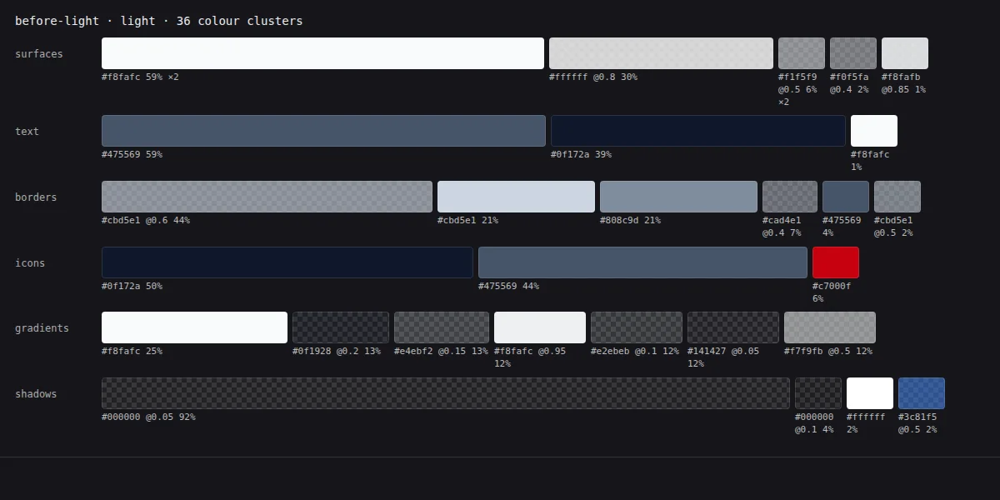
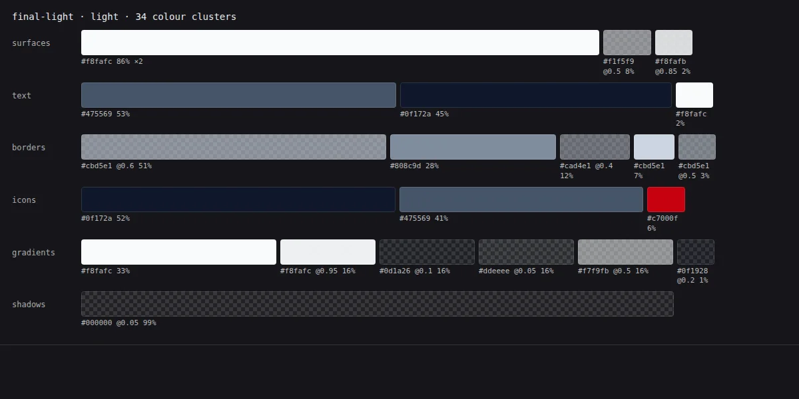
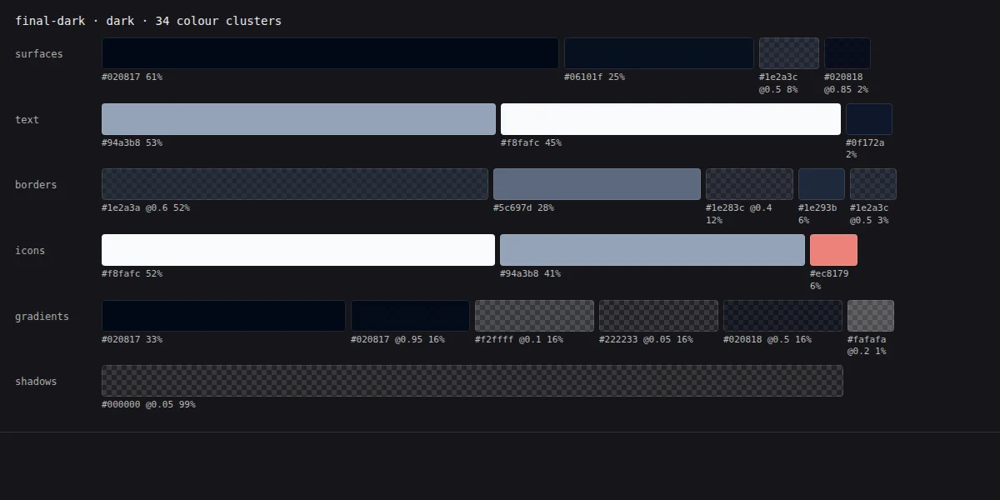

# Runtime palette cards

These cards were generated from computed colors in real rendered desktop routes, not a static token list. The runtime audit sampled library, upload, roles, and Settings General. They show the sample’s color families and weighted surface/text/border/icon/gradient/shadow roles. Color clustering and palette size are inventory measurements, not contrast certification or an app-wide AA result. The original raw JSON/Markdown metrics are unchanged and are not republished in this package.

Only a light baseline palette card is available. The final dark card is after-only; no dark baseline has been invented. Images retain native card geometry and are encoded as WebP quality 84. Generation timestamps and source/output hashes are in [extras-manifest.json](extras-manifest.json).

## Before, light

## After, light

## After, dark (no baseline card)

