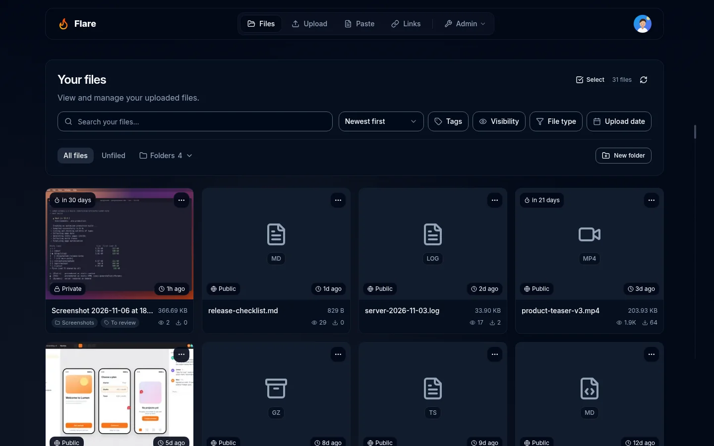
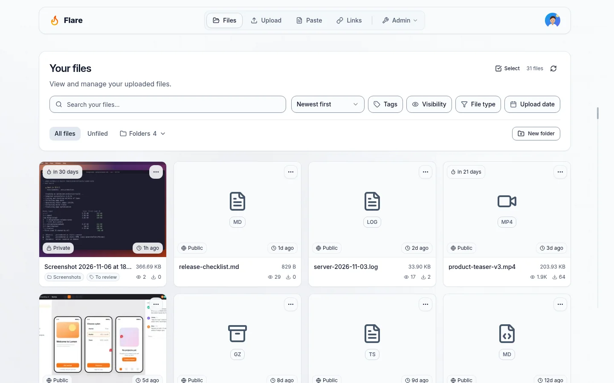
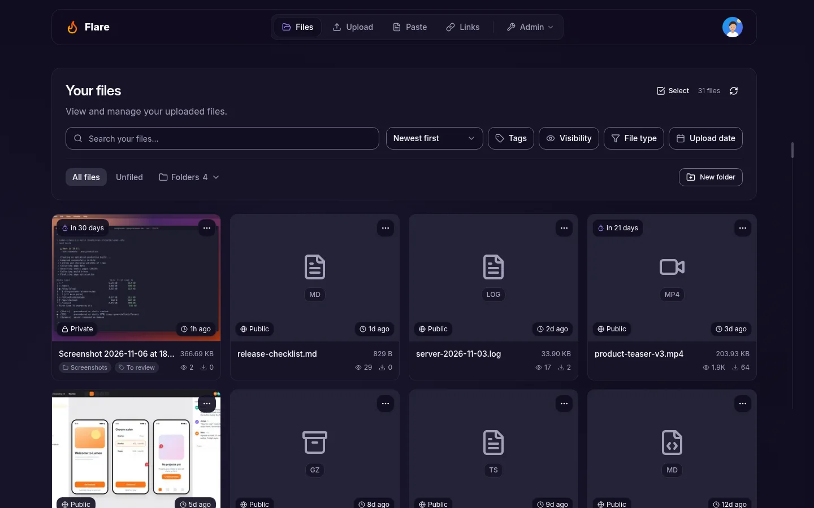
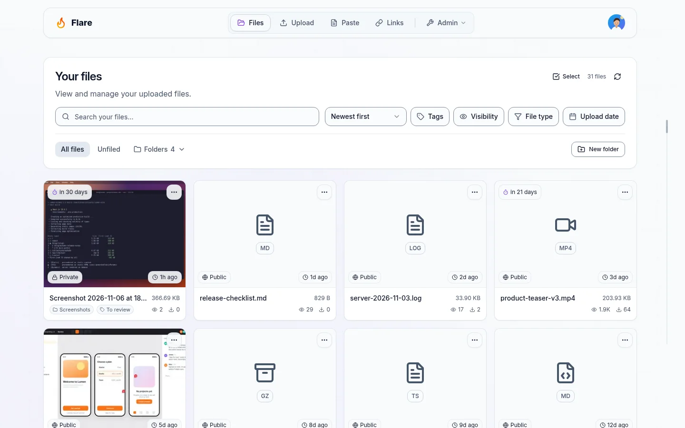
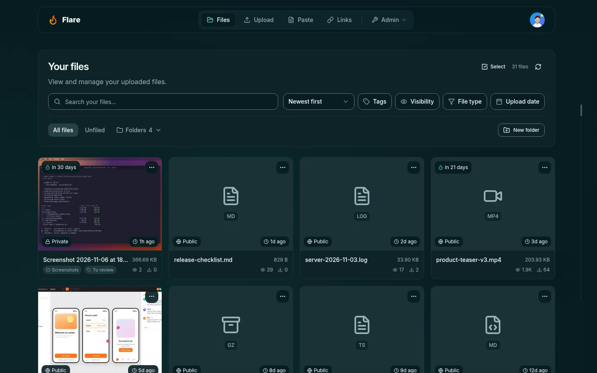
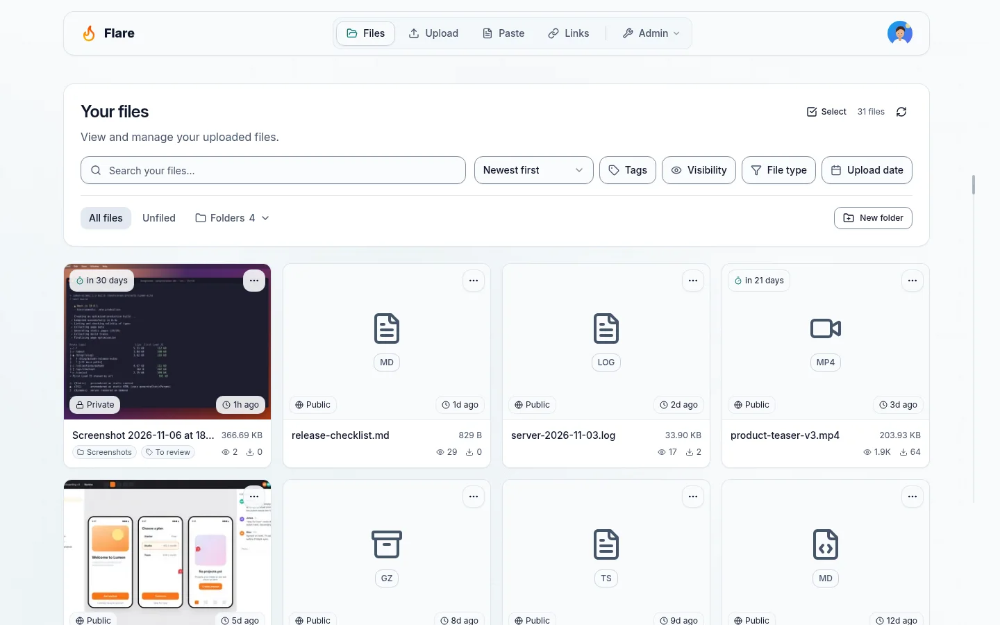
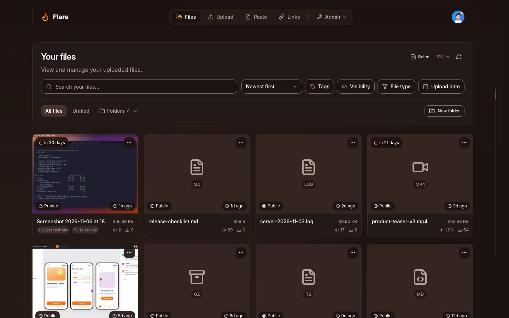
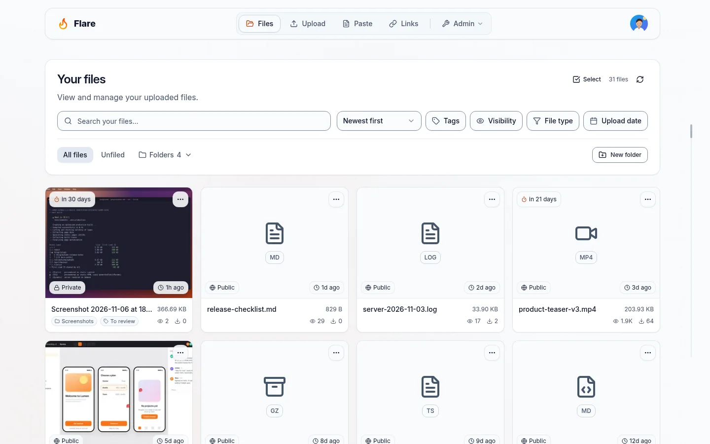
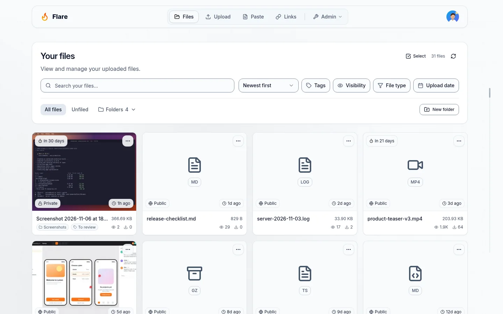
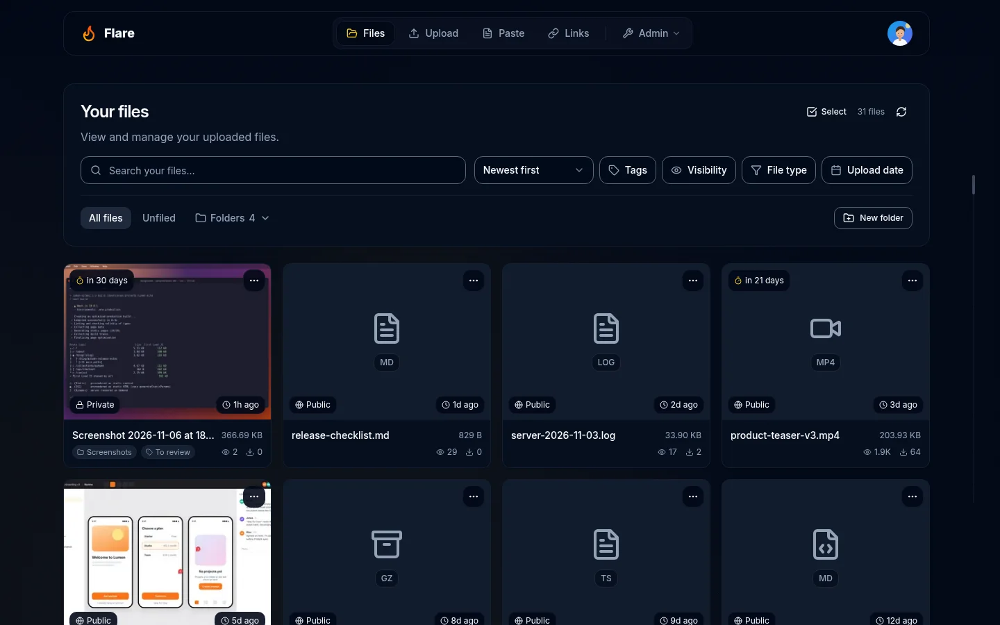

# Studio presets and accent stress cases

**After-only evidence.** These 132 frames are real application captures, not generated mockups. No matching preset baseline was captured, so no before comparison is implied. Each link opens the complete native-size frame, encoded as WebP quality 84 without resizing or cropping.

The capture indexes report isolated `http://localhost:3195`, 6 routes, 2 viewports, and 11 appearance states. Desktop viewport is 1440 × 900; phone viewport is 390 × 844. Some routes use full-page capture and are taller. Dates, original source paths, source hashes, output hashes, and geometry are recorded in [extras-manifest.json](extras-manifest.json). Every indexed capture reports an empty capture-error list. The indexes do not record a per-frame build ID.

The studio palette was enabled through the disposable fixture using the task capture script with `PRESET_STYLE=new`. Midnight, Orbit, Tide, and Ember have dark/light captures; white-on-dark, black-on-light, and saturated yellow are additional stress cases. These are screenshots of those states, not a claim that arbitrary user colors are accessible. Full-page captures use the shared capture stylesheet to extend fixed background layers; no screenshot reconstruction was performed.

**Verification:** the original preset audit incorrectly sampled the clipped, aria-hidden skip link under an open menu (22 findings). All original raw reports are retained. A later production build fixes the visible link positioning and remeasures the user-action menu in every preset; those actual reruns have zero AA text failures. [Measurement method and results](validation.md) explain the scopes and limits.

## Midnight, dark

| State               | Desktop                                                                 | Phone                                                                 |
| ------------------- | ----------------------------------------------------------------------- | --------------------------------------------------------------------- |
| library             | [1440 × 900](presets/frames/midnight/desktop/library.webp)              | [390 × 844](presets/frames/midnight/mobile/library.webp)              |
| filter-date         | [1440 × 900](presets/frames/midnight/desktop/filter-date.webp)          | [390 × 844](presets/frames/midnight/mobile/filter-date.webp)          |
| settings-appearance | [1440 × 1846](presets/frames/midnight/desktop/settings-appearance.webp) | [390 × 2909](presets/frames/midnight/mobile/settings-appearance.webp) |
| upload-options      | [1440 × 1215](presets/frames/midnight/desktop/upload-options.webp)      | [390 × 1351](presets/frames/midnight/mobile/upload-options.webp)      |
| user-actions        | [1440 × 900](presets/frames/midnight/desktop/user-actions.webp)         | [390 × 844](presets/frames/midnight/mobile/user-actions.webp)         |
| roles-expanded      | [1440 × 2544](presets/frames/midnight/desktop/roles-expanded.webp)      | [390 × 3441](presets/frames/midnight/mobile/roles-expanded.webp)      |

## Midnight, light

| State               | Desktop                                                                       | Phone                                                                       |
| ------------------- | ----------------------------------------------------------------------------- | --------------------------------------------------------------------------- |
| library             | [1440 × 900](presets/frames/midnight-light/desktop/library.webp)              | [390 × 844](presets/frames/midnight-light/mobile/library.webp)              |
| filter-date         | [1440 × 900](presets/frames/midnight-light/desktop/filter-date.webp)          | [390 × 844](presets/frames/midnight-light/mobile/filter-date.webp)          |
| settings-appearance | [1440 × 1846](presets/frames/midnight-light/desktop/settings-appearance.webp) | [390 × 2909](presets/frames/midnight-light/mobile/settings-appearance.webp) |
| upload-options      | [1440 × 1215](presets/frames/midnight-light/desktop/upload-options.webp)      | [390 × 1351](presets/frames/midnight-light/mobile/upload-options.webp)      |
| user-actions        | [1440 × 900](presets/frames/midnight-light/desktop/user-actions.webp)         | [390 × 844](presets/frames/midnight-light/mobile/user-actions.webp)         |
| roles-expanded      | [1440 × 2544](presets/frames/midnight-light/desktop/roles-expanded.webp)      | [390 × 3441](presets/frames/midnight-light/mobile/roles-expanded.webp)      |

## Orbit, dark

| State               | Desktop                                                              | Phone                                                              |
| ------------------- | -------------------------------------------------------------------- | ------------------------------------------------------------------ |
| library             | [1440 × 900](presets/frames/orbit/desktop/library.webp)              | [390 × 844](presets/frames/orbit/mobile/library.webp)              |
| filter-date         | [1440 × 900](presets/frames/orbit/desktop/filter-date.webp)          | [390 × 844](presets/frames/orbit/mobile/filter-date.webp)          |
| settings-appearance | [1440 × 1846](presets/frames/orbit/desktop/settings-appearance.webp) | [390 × 2909](presets/frames/orbit/mobile/settings-appearance.webp) |
| upload-options      | [1440 × 1215](presets/frames/orbit/desktop/upload-options.webp)      | [390 × 1351](presets/frames/orbit/mobile/upload-options.webp)      |
| user-actions        | [1440 × 900](presets/frames/orbit/desktop/user-actions.webp)         | [390 × 844](presets/frames/orbit/mobile/user-actions.webp)         |
| roles-expanded      | [1440 × 2544](presets/frames/orbit/desktop/roles-expanded.webp)      | [390 × 3441](presets/frames/orbit/mobile/roles-expanded.webp)      |

## Orbit, light

| State               | Desktop                                                                    | Phone                                                                    |
| ------------------- | -------------------------------------------------------------------------- | ------------------------------------------------------------------------ |
| library             | [1440 × 900](presets/frames/orbit-light/desktop/library.webp)              | [390 × 844](presets/frames/orbit-light/mobile/library.webp)              |
| filter-date         | [1440 × 900](presets/frames/orbit-light/desktop/filter-date.webp)          | [390 × 844](presets/frames/orbit-light/mobile/filter-date.webp)          |
| settings-appearance | [1440 × 1846](presets/frames/orbit-light/desktop/settings-appearance.webp) | [390 × 2909](presets/frames/orbit-light/mobile/settings-appearance.webp) |
| upload-options      | [1440 × 1215](presets/frames/orbit-light/desktop/upload-options.webp)      | [390 × 1351](presets/frames/orbit-light/mobile/upload-options.webp)      |
| user-actions        | [1440 × 900](presets/frames/orbit-light/desktop/user-actions.webp)         | [390 × 844](presets/frames/orbit-light/mobile/user-actions.webp)         |
| roles-expanded      | [1440 × 2544](presets/frames/orbit-light/desktop/roles-expanded.webp)      | [390 × 3441](presets/frames/orbit-light/mobile/roles-expanded.webp)      |

## Tide, dark

| State               | Desktop                                                             | Phone                                                             |
| ------------------- | ------------------------------------------------------------------- | ----------------------------------------------------------------- |
| library             | [1440 × 900](presets/frames/tide/desktop/library.webp)              | [390 × 844](presets/frames/tide/mobile/library.webp)              |
| filter-date         | [1440 × 900](presets/frames/tide/desktop/filter-date.webp)          | [390 × 844](presets/frames/tide/mobile/filter-date.webp)          |
| settings-appearance | [1440 × 1846](presets/frames/tide/desktop/settings-appearance.webp) | [390 × 2909](presets/frames/tide/mobile/settings-appearance.webp) |
| upload-options      | [1440 × 1215](presets/frames/tide/desktop/upload-options.webp)      | [390 × 1351](presets/frames/tide/mobile/upload-options.webp)      |
| user-actions        | [1440 × 900](presets/frames/tide/desktop/user-actions.webp)         | [390 × 844](presets/frames/tide/mobile/user-actions.webp)         |
| roles-expanded      | [1440 × 2544](presets/frames/tide/desktop/roles-expanded.webp)      | [390 × 3441](presets/frames/tide/mobile/roles-expanded.webp)      |

## Tide, light

| State               | Desktop                                                                   | Phone                                                                   |
| ------------------- | ------------------------------------------------------------------------- | ----------------------------------------------------------------------- |
| library             | [1440 × 900](presets/frames/tide-light/desktop/library.webp)              | [390 × 844](presets/frames/tide-light/mobile/library.webp)              |
| filter-date         | [1440 × 900](presets/frames/tide-light/desktop/filter-date.webp)          | [390 × 844](presets/frames/tide-light/mobile/filter-date.webp)          |
| settings-appearance | [1440 × 1846](presets/frames/tide-light/desktop/settings-appearance.webp) | [390 × 2909](presets/frames/tide-light/mobile/settings-appearance.webp) |
| upload-options      | [1440 × 1215](presets/frames/tide-light/desktop/upload-options.webp)      | [390 × 1351](presets/frames/tide-light/mobile/upload-options.webp)      |
| user-actions        | [1440 × 900](presets/frames/tide-light/desktop/user-actions.webp)         | [390 × 844](presets/frames/tide-light/mobile/user-actions.webp)         |
| roles-expanded      | [1440 × 2544](presets/frames/tide-light/desktop/roles-expanded.webp)      | [390 × 3441](presets/frames/tide-light/mobile/roles-expanded.webp)      |

## Ember, dark

| State               | Desktop                                                              | Phone                                                              |
| ------------------- | -------------------------------------------------------------------- | ------------------------------------------------------------------ |
| library             | [1440 × 900](presets/frames/ember/desktop/library.webp)              | [390 × 844](presets/frames/ember/mobile/library.webp)              |
| filter-date         | [1440 × 900](presets/frames/ember/desktop/filter-date.webp)          | [390 × 844](presets/frames/ember/mobile/filter-date.webp)          |
| settings-appearance | [1440 × 1846](presets/frames/ember/desktop/settings-appearance.webp) | [390 × 2909](presets/frames/ember/mobile/settings-appearance.webp) |
| upload-options      | [1440 × 1215](presets/frames/ember/desktop/upload-options.webp)      | [390 × 1351](presets/frames/ember/mobile/upload-options.webp)      |
| user-actions        | [1440 × 900](presets/frames/ember/desktop/user-actions.webp)         | [390 × 844](presets/frames/ember/mobile/user-actions.webp)         |
| roles-expanded      | [1440 × 2544](presets/frames/ember/desktop/roles-expanded.webp)      | [390 × 3441](presets/frames/ember/mobile/roles-expanded.webp)      |

## Ember, light

| State               | Desktop                                                                    | Phone                                                                    |
| ------------------- | -------------------------------------------------------------------------- | ------------------------------------------------------------------------ |
| library             | [1440 × 900](presets/frames/ember-light/desktop/library.webp)              | [390 × 844](presets/frames/ember-light/mobile/library.webp)              |
| filter-date         | [1440 × 900](presets/frames/ember-light/desktop/filter-date.webp)          | [390 × 844](presets/frames/ember-light/mobile/filter-date.webp)          |
| settings-appearance | [1440 × 1846](presets/frames/ember-light/desktop/settings-appearance.webp) | [390 × 2909](presets/frames/ember-light/mobile/settings-appearance.webp) |
| upload-options      | [1440 × 1215](presets/frames/ember-light/desktop/upload-options.webp)      | [390 × 1351](presets/frames/ember-light/mobile/upload-options.webp)      |
| user-actions        | [1440 × 900](presets/frames/ember-light/desktop/user-actions.webp)         | [390 × 844](presets/frames/ember-light/mobile/user-actions.webp)         |
| roles-expanded      | [1440 × 2544](presets/frames/ember-light/desktop/roles-expanded.webp)      | [390 × 3441](presets/frames/ember-light/mobile/roles-expanded.webp)      |

## White accent on dark

| State               | Desktop                                                                | Phone                                                                |
| ------------------- | ---------------------------------------------------------------------- | -------------------------------------------------------------------- |
| library             | [1440 × 900](presets/frames/extreme/desktop/library.webp)              | [390 × 844](presets/frames/extreme/mobile/library.webp)              |
| filter-date         | [1440 × 900](presets/frames/extreme/desktop/filter-date.webp)          | [390 × 844](presets/frames/extreme/mobile/filter-date.webp)          |
| settings-appearance | [1440 × 1846](presets/frames/extreme/desktop/settings-appearance.webp) | [390 × 2909](presets/frames/extreme/mobile/settings-appearance.webp) |
| upload-options      | [1440 × 1215](presets/frames/extreme/desktop/upload-options.webp)      | [390 × 1351](presets/frames/extreme/mobile/upload-options.webp)      |
| user-actions        | [1440 × 900](presets/frames/extreme/desktop/user-actions.webp)         | [390 × 844](presets/frames/extreme/mobile/user-actions.webp)         |
| roles-expanded      | [1440 × 2544](presets/frames/extreme/desktop/roles-expanded.webp)      | [390 × 3441](presets/frames/extreme/mobile/roles-expanded.webp)      |

## Black accent on light

| State               | Desktop                                                                      | Phone                                                                      |
| ------------------- | ---------------------------------------------------------------------------- | -------------------------------------------------------------------------- |
| library             | [1440 × 900](presets/frames/extreme-light/desktop/library.webp)              | [390 × 844](presets/frames/extreme-light/mobile/library.webp)              |
| filter-date         | [1440 × 900](presets/frames/extreme-light/desktop/filter-date.webp)          | [390 × 844](presets/frames/extreme-light/mobile/filter-date.webp)          |
| settings-appearance | [1440 × 1846](presets/frames/extreme-light/desktop/settings-appearance.webp) | [390 × 2909](presets/frames/extreme-light/mobile/settings-appearance.webp) |
| upload-options      | [1440 × 1215](presets/frames/extreme-light/desktop/upload-options.webp)      | [390 × 1351](presets/frames/extreme-light/mobile/upload-options.webp)      |
| user-actions        | [1440 × 900](presets/frames/extreme-light/desktop/user-actions.webp)         | [390 × 844](presets/frames/extreme-light/mobile/user-actions.webp)         |
| roles-expanded      | [1440 × 2544](presets/frames/extreme-light/desktop/roles-expanded.webp)      | [390 × 3441](presets/frames/extreme-light/mobile/roles-expanded.webp)      |

## Saturated yellow accent on dark

| State               | Desktop                                                                  | Phone                                                                  |
| ------------------- | ------------------------------------------------------------------------ | ---------------------------------------------------------------------- |
| library             | [1440 × 900](presets/frames/saturated/desktop/library.webp)              | [390 × 844](presets/frames/saturated/mobile/library.webp)              |
| filter-date         | [1440 × 900](presets/frames/saturated/desktop/filter-date.webp)          | [390 × 844](presets/frames/saturated/mobile/filter-date.webp)          |
| settings-appearance | [1440 × 1846](presets/frames/saturated/desktop/settings-appearance.webp) | [390 × 2909](presets/frames/saturated/mobile/settings-appearance.webp) |
| upload-options      | [1440 × 1215](presets/frames/saturated/desktop/upload-options.webp)      | [390 × 1351](presets/frames/saturated/mobile/upload-options.webp)      |
| user-actions        | [1440 × 900](presets/frames/saturated/desktop/user-actions.webp)         | [390 × 844](presets/frames/saturated/mobile/user-actions.webp)         |
| roles-expanded      | [1440 × 2544](presets/frames/saturated/desktop/roles-expanded.webp)      | [390 × 3441](presets/frames/saturated/mobile/roles-expanded.webp)      |
