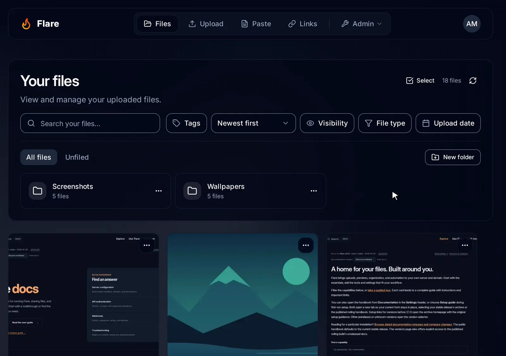
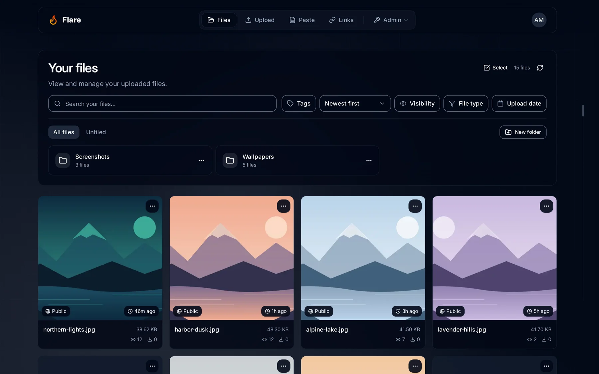
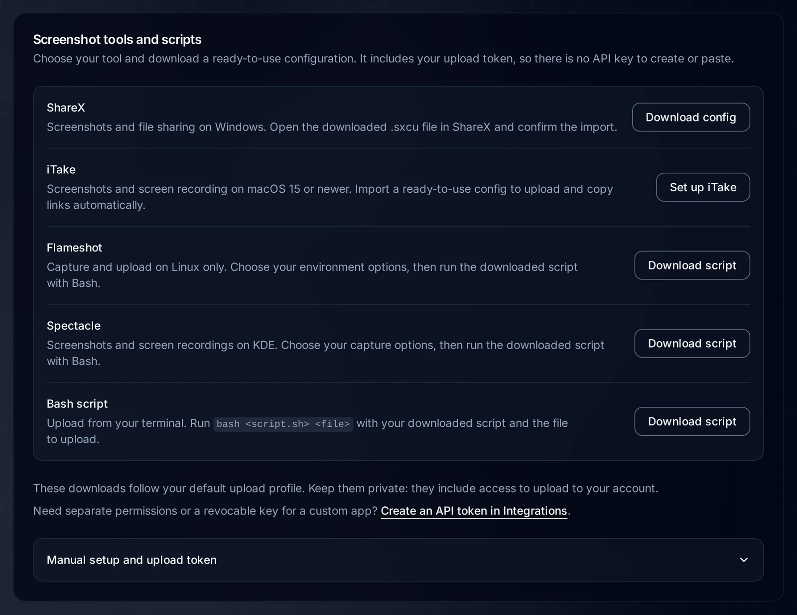

<div align="center">
  
  <h1>Flare</h1>
  <p><strong>Your own file host for screenshots, files, pastes and short links.</strong></p>

[](https://github.com/FlintSH/Flare/releases)
[](https://hub.docker.com/r/flintsh/flare)
[](https://discord.gg/mwVAjKwPus)
[](LICENSE)

[**Website**](https://flintsh.github.io/Flare/) · [Documentation](https://flintsh.github.io/Flare/guide/) · [Install](#quick-start) · [Demos](https://flintsh.github.io/Flare/demos.html) · [API](https://flintsh.github.io/Flare/api/)

</div>

Flare runs on your server and your domain. Upload from the browser or straight from
ShareX, Flameshot, Spectacle, iTake or a shell script, and share the link. All it
needs is PostgreSQL and a container host.

<p align="center">
  <a href="https://flintsh.github.io/Flare/demos.html">
    <picture>
      <source media="(prefers-color-scheme: light)" srcset="./.github/assets/readme/demo-light.webp" />
      
    </picture>
  </a>
  <br />
  <sub>Drop a file, open it, copy the link. Recorded in a real Flare instance with demo data.</sub>
</p>

## What you get

- **Uploads from your screenshot tool.** Import a ready-made config for ShareX or
  iTake, download a capture script for Flameshot or Spectacle, or get a Bash
  uploader. Your upload token is already filled in.
- **Links that preview.** Image and video links appear on their own in Discord,
  Slack and other chat apps, or inside a card you write yourself with a site name,
  author line and accent color. In the browser, images, video, audio, PDFs, CSV
  files and code open in a clean viewer.
- **Pastes and short links.** Share code with syntax highlighting, and shorten URLs
  under your own domain with click counts.
- **A library that stays usable.** Folders, tags, search that includes text found in
  images (OCR), and smooth scrolling with a date rail for large libraries.
- **Control over every link.** Public, private or password-protected files, expiry
  dates, and shareable folders.
- **Room for other people.** Invite links, roles and permissions, storage quotas,
  single sign-on (OIDC), two-factor and passkeys, and an audit log.
- **Your look, your storage.** Brand the instance and its share pages, and keep
  files on local disk or any S3-compatible bucket.
- **Built to integrate.** Scoped API tokens, an OpenAPI description and signed
  webhooks.

The [feature explorer](https://flintsh.github.io/Flare/features.html) covers each
of these with a guide.

## Quick start

**Railway**

[](https://railway.com/template/JVT41u?referralCode=R5s8WT)

Start from the template, check the [Railway guide](https://flintsh.github.io/Flare/hosting/railway.html)
for storage and domain settings, then open `/setup`.

**Docker Compose**

You need Docker with the Compose plugin and OpenSSL.

1. In an empty directory, create a `.env` with two fresh secrets:

   ```sh
   umask 077
   printf 'POSTGRES_PASSWORD=%s\nNEXTAUTH_SECRET=%s\nNEXTAUTH_URL=http://localhost:3000\n' \
     "$(openssl rand -hex 32)" "$(openssl rand -hex 32)" > .env
   ```

2. Expand **compose.yaml** below and save it in the same directory.
3. Start Flare:

   ```sh
   docker compose up -d
   ```

4. Open `http://localhost:3000/setup` and create your account. The first account
   is the administrator. If Docker runs on another machine, first run
   `ssh -L 3000:127.0.0.1:3000 you@your-server` on your computer and keep it open.

<details>
<summary><b>compose.yaml</b></summary>

```yaml
name: flare

services:
  db:
    image: postgres:16-alpine
    restart: unless-stopped
    environment:
      POSTGRES_USER: flare
      POSTGRES_PASSWORD: ${POSTGRES_PASSWORD:?Set POSTGRES_PASSWORD in .env}
      POSTGRES_DB: flare
    volumes:
      - postgres_data:/var/lib/postgresql/data
    healthcheck:
      test: ['CMD-SHELL', 'pg_isready -U flare -d flare']
      interval: 10s
      timeout: 5s
      retries: 10

  flare:
    image: ${FLARE_IMAGE:-flintsh/flare:latest}
    restart: unless-stopped
    ports:
      - '127.0.0.1:3000:3000'
    environment:
      DATABASE_URL: postgresql://flare:${POSTGRES_PASSWORD:?Set POSTGRES_PASSWORD in .env}@db:5432/flare?schema=public
      NEXTAUTH_SECRET: ${NEXTAUTH_SECRET:?Set NEXTAUTH_SECRET in .env}
      NEXTAUTH_URL: ${NEXTAUTH_URL:?Set NEXTAUTH_URL in .env}
    volumes:
      - uploads:/app/uploads
    depends_on:
      db:
        condition: service_healthy

volumes:
  postgres_data:
  uploads:
```

</details>

Flare listens on `127.0.0.1:3000` only. To use it from other devices, put it
behind [a reverse proxy with HTTPS](https://flintsh.github.io/Flare/hosting/reverse-proxy.html)
and set `NEXTAUTH_URL` to your public address. The [Docker guide](https://flintsh.github.io/Flare/hosting/docker.html)
covers pinning a version, existing databases and remote servers. Images are
published as `flintsh/flare` and `ghcr.io/flintsh/flare` for AMD64 and ARM64.

To update, [take a backup](https://flintsh.github.io/Flare/hosting/maintenance.html#upgrade-flare),
then run `docker compose pull flare && docker compose up -d flare`.

## A closer look

<picture>
  <source media="(prefers-color-scheme: light)" srcset="./.github/assets/readme/library-light.webp" />
  
</picture>
<p align="center"><sub><b>Your library.</b> Search, filter and organize everything you upload.</sub></p>

<picture>
  <source media="(prefers-color-scheme: light)" srcset="./.github/assets/readme/screenshot-tools-light.webp" />
  
</picture>
<p align="center"><sub><b>Screenshot tools.</b> Download a config or script with your instance and upload token filled in.</sub></p>

More screens and recorded walkthroughs are in the [interactive demos](https://flintsh.github.io/Flare/demos.html).

## Documentation

The [Flare handbook](https://flintsh.github.io/Flare/guide/) covers using, running and
extending Flare, with docs archived for every stable release.

| I want to…               | Start with                                                                                                                                |
| ------------------------ | ----------------------------------------------------------------------------------------------------------------------------------------- |
| Run Flare                | [Deployment](https://flintsh.github.io/Flare/hosting/) · [Backups and upgrades](https://flintsh.github.io/Flare/hosting/maintenance.html) |
| Set up my screenshot app | [Screenshot tools](https://flintsh.github.io/Flare/guide/screenshot-tools.html)                                                           |
| Share and organize files | [Sharing and privacy](https://flintsh.github.io/Flare/guide/sharing.html) · [Folders](https://flintsh.github.io/Flare/guide/folders.html) |
| Run it for a group       | [First-run setup](https://flintsh.github.io/Flare/admin/setup.html) · [Roles](https://flintsh.github.io/Flare/admin/roles.html)           |
| Build an integration     | [API](https://flintsh.github.io/Flare/api/) · [Webhooks](https://flintsh.github.io/Flare/api/webhooks.html)                               |
| Fix a problem            | [Troubleshooting](https://flintsh.github.io/Flare/hosting/troubleshooting.html)                                                           |

## Community

- **Help and updates:** join the [Discord](https://discord.gg/mwVAjKwPus).
- **Bugs and ideas:** open an [issue](https://github.com/FlintSH/Flare/issues).
- **Contributing:** read [CONTRIBUTING.md](CONTRIBUTING.md) and the
  [docs contribution guide](docs/site/contributing.md).
- **Security reports:** follow [SECURITY.md](SECURITY.md).

## License

Flare is MIT licensed and made by [FlintSH](https://fl1nt.dev). Icon designed by
[xNefas](https://ko-fi.com/xnefas/).
